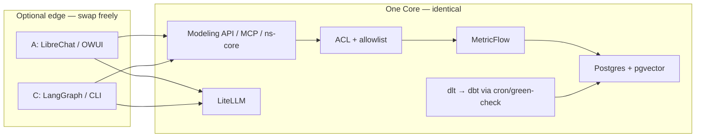
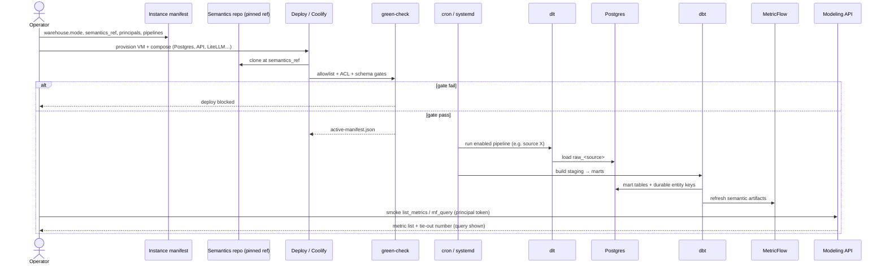
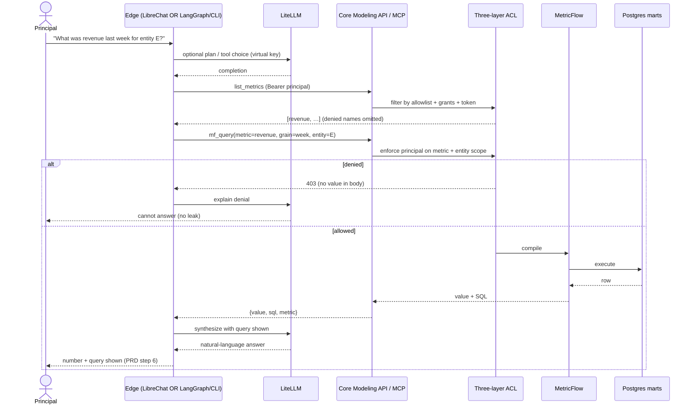
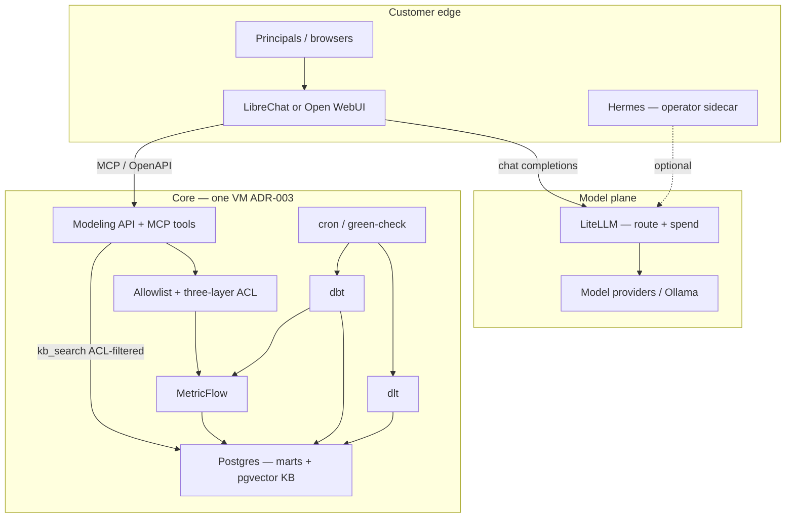
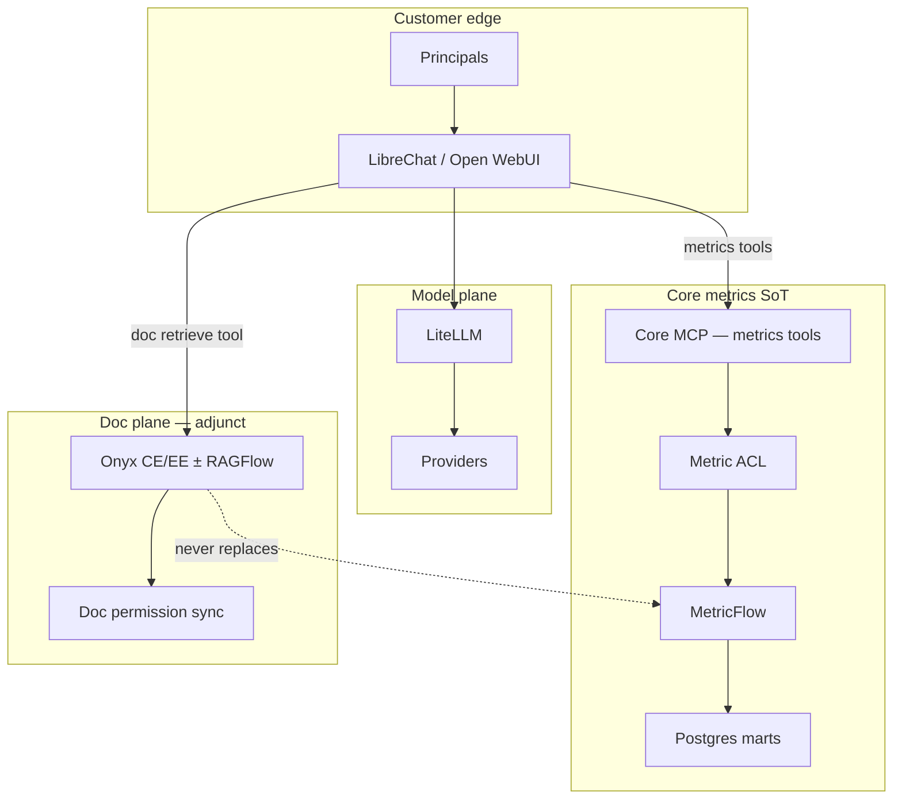
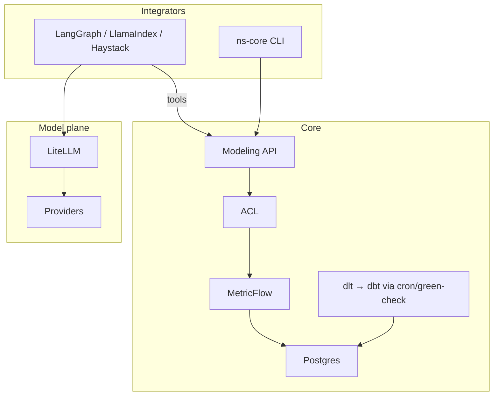

# Chat with modeled data — architecture prototype

**Verdict:** Thin chat/agent shell → **Core MCP/OpenAPI** (MetricFlow + ACL SoT). **LiteLLM** for model routing/spend. **pgvector-in-Postgres** for IP/KB adjunct. **cron + green-check** for v1 pipeline runtime (Prefect or Kestra upgrade path). Chat chrome never owns warehouse, metrics, or ACL.

**Archify HTML:** [`chat-data-plane/`](./chat-data-plane/) (lean primary). Mermaid variants below for operator compare.

---

## Variant compare

| Variant | When | Harness | KB plane | Scheduler | VM weight |
|---|---|---|---|---|---|
| **A — Lean Core+LibreChat** | Default packaging | LibreChat (OWUI swap OK) | pgvector + Core `kb_*` tools | cron + green-check | L–M |
| **B — Core+Onyx dual-plane** | Org-doc SKU sold | LibreChat/OWUI | Onyx (± RAGFlow) + Core metrics tools | same as A | M–H |
| **C — Headless-first** | PRD walking skeleton / G8→B | LangGraph (or CLI) only | optional later | cron + green-check | L |

**Hermes:** operator/internal sidecar only (pattern + BYO model). Not customer UI. Aligns with research; ADR-001 wording still says Hermes v0 — **open operator revisit**.

---

## Core context: Variant A vs C (same spine)

**Yes — Core is the same thing whether or not a customer edge exists.** A and C are packaging profiles over one data plane, not two Cores.

| Layer | Shared Core (A and C) | A only (customer edge) | C only (integrator edge) |
|---|---|---|---|
| Ingest / transform | dlt → Postgres → dbt marts | — | — |
| Metrics SoT | MetricFlow + allowlist + three-layer ACL | — | — |
| Product surface | Modeling API + `ns-core` CLI (+ MCP when shipped) | LibreChat/OWUI → same API/MCP | LangGraph / LlamaIndex / Haystack / CLI → same API/MCP |
| Models / spend | LiteLLM (when any agent/chat on) | Harness base URL → LiteLLM | Agent SDK base URL → LiteLLM |
| IP / KB | pgvector + Core `kb_*` (optional) | Exposed as chat tools | Same tools if agent binds them |
| Pipelines | cron + green-check | — | — |



**Implication:** Prove PRD step 6 on C (headless). Turn on compose profile `chat-ui` for A without changing semantics, ACL, or MetricFlow. Do not fork Core for chat.

---

## Sequence — initial pipelines, then chat a metric

Same Core path for A and C. Edge differs only at the left: LibreChat vs LangGraph/`ns-core`.

### 1. Setup — provision + first green pipeline



### 2. Chat — ask a specific metric (A or C)



Invariant: warehouse DSN never leaves Core. Edge and LiteLLM see tools/tokens only.

---

## Target repo layout (Core + optional edge)

Maps onto today’s shell (`manifest/`, `semantics/`, `compose/`, `deploy/`, `acl/`) plus chat/agent profiles. Private tenant code stays in the pinned semantics repo.

```
narrowstack-core/                    # OSS shell (this repo)
├── manifest/
│   ├── schema.json
│   └── examples/
│       ├── example-local-warehouse.yaml
│       └── example-external-warehouse.yaml
├── acl/                             # framework + sensitivity defaults
├── semantics/                       # in-repo TEMPLATES only (not tenant IP)
│   ├── dlt_pipelines/
│   ├── dbt_project/
│   ├── allowlist/
│   └── acl/
├── compose/
│   ├── local-warehouse/             # Postgres (+ pgvector), base Core
│   ├── external-warehouse/
│   ├── modeling-api/                # Modeling API (+ MCP when shipped)
│   ├── litellm/                     # model route + spend (profile)
│   └── chat-ui/                     # Variant A overlay: LibreChat|OWUI
├── deploy/
│   ├── green-check.sh
│   ├── allowlist-gate.sh
│   ├── acl-apply.sh
│   └── smoke-query.sh
├── api/                             # Modeling API service (Phase B)
│   └── openapi/
├── mcp/                             # MCP server wrapping same API contract
├── examples/
│   └── headless-agent/              # Variant C: LangGraph walking skeleton
│       ├── graph.py                 # tools → Core MCP/OpenAPI
│       ├── eval_fixtures.yaml       # known question → known number
│       └── README.md
├── scripts/
│   ├── ns-core                      # CLI entry
│   └── clone-semantics.sh
└── docs/
    ├── architecture/chat-with-modeled-data.md
    └── features/modeling-api.md

# Separate private repo (pinned by manifest.semantics_ref)
tenant-semantics-<customer>/
├── deploy/manifest.yaml
├── dlt_pipelines/                   # real sources
├── dbt_project/                     # marts + entity keys
├── metrics/                         # MetricFlow defs
├── allowlist/internal.yaml
└── kb/                              # optional IP docs → pgvector ingest
```

**Customer boilerplate (ideal appliance):**

1. Copy `manifest/examples/example-local-warehouse.yaml` → set `semantics_ref`, principals, pipeline enable flags.  
2. Fork semantics template → private repo; one source, one mart, one metric.  
3. Enable compose profiles: `local-warehouse` + `modeling-api` (+ `litellm` when agents on).  
4. Deploy → green-check → cron runs dlt/dbt.  
5. **C:** run `examples/headless-agent` (or `ns-core` query) for PRD step 6.  
6. **A:** enable `chat-ui` profile; point harness MCP at Core and OpenAI base URL at LiteLLM.  

Same Core steps 1–4 for both; edge is step 5 vs 6.

---

## Options matrix (new slots)

| Slot | Recommendation | Alternate | Avoid |
|---|---|---|---|
| **Scheduler** | **Adopt** cron/systemd + Core `green-check` / CI | Prefect or Kestra when run UX / retries needed | Airflow default; Mage unless already owned |
| **LLM gateway** | **Self-host LiteLLM** (budgets, OpenAI-compat) | Portkey gateway (MIT) or Bifrost (Apache-2.0) | OmniRoute as Core product; Kong unless ops already runs it |
| **Vector/KB** | **Self-host pgvector** in Core Postgres | Qdrant if scale; Onyx/RAGFlow for connectors | Vector RAG as MetricFlow SoT; Elasticsearch-heavy default |

Harness / dlt / dbt / MetricFlow picks unchanged from research pack — see executive summary.

---

## How the harness talks to each plane

| Plane | Protocol | Auth | What it may answer |
|---|---|---|---|
| **Metrics / marts** | Core MCP + Modeling API (`list_metrics`, `get_manifest`, `mf_query`) | Principal token → three-layer ACL | Numbers from MetricFlow only; query shown |
| **IP / docs KB** | Core `kb_search` / `kb_cite` tools (or Onyx retrieve tool in variant B) | Same principal + doc ACL filter | Citations / excerpts — **never** metric definitions as SoT |
| **Models / spend** | Harness OpenAI base URL → **LiteLLM** → providers | LiteLLM virtual keys + per-principal budgets | Completions only; no warehouse credentials |

Invariant: LiteLLM never holds warehouse DSNs. Vector index never stores MetricFlow metric definitions as authoritative truth (docs may *describe* metrics; queries go through Core).

---

## Variant A — Lean Core+LibreChat (primary)



---

## Variant B — Core+Onyx dual-plane



**Risk:** dual ACL. Mitigate by product copy + tool naming: metrics tools vs doc tools; no silent merge of Onyx answers into “the number.”

---

## Variant C — Headless-first



Proves PRD step 6 before packaging a chat UI. LibreChat lands later without changing Core tools. **Core subgraph ≡ Variant A Core** — see [Core context](#core-context-variant-a-vs-c-same-spine).

Full setup + metric-chat sequences: [Sequence — initial pipelines, then chat a metric](#sequence--initial-pipelines-then-chat-a-metric).

---

## Compose footprint (lean A)

| Service | Role | Required v1 |
|---|---|---|
| Postgres (+ pgvector) | Warehouse / marts / KB | Yes (`warehouse.mode: local`) |
| dlt workers | Ingest | Yes (enabled pipelines) |
| dbt | Transforms | Yes |
| MetricFlow + Modeling API/MCP | Metrics SoT + tools | Yes |
| LiteLLM | Route + spend | Yes when chat/agent on |
| LibreChat (or OWUI) | Customer harness | After headless proof |
| Hermes | Operator only | Optional |
| Onyx / RAGFlow / Qdrant / Prefect | Adjuncts | No until sold / scaled |

`warehouse.mode: external` keeps MetricFlow + API + LiteLLM + harness against customer DSN; dlt/dbt may run off-box per customer ops.

---

## Operator decisions still open

1. LibreChat vs Open WebUI packaging (license / SCIM weight) — stars lean OWUI; shortlist still LibreChat MIT default.  
2. Stamp ADR-001: Hermes operator-sidecar vs keep “v0 runtime” language.  
3. When to introduce Prefect vs Kestra (RAM vs run UX).  
4. Org-doc SKU → variant B timing (Onyx CE vs EE permission sync).  
5. LiteLLM license diligence; optional Bifrost spike.  
6. pgvector embedding path (local model via Ollama vs cloud via LiteLLM).

---

## Related artifacts

| Artifact | Path |
|---|---|
| Harness research | `docs/product/research/oss-agent-harness-chat-data-20260922/` |
| Slot discovery (this run) | `…/slot-discovery-20260922.md` |
| Archify lean A | `docs/architecture/chat-data-plane/` |
| Core overview | `docs/architecture/overview.md` |
| Canonical plan | `docs/plans/narrowstack-core-architecture-20260831.md` |
