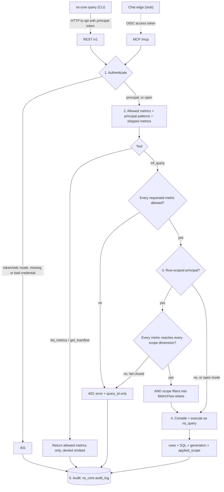

# Access control: the front door and bouncer

**Summary:** Every metric read enters Core through one enforcement library behind the Modeling API: REST `/v1`, MCP `/mcp`, and the `ns-core` CLI (which calls the API). That library authenticates the caller, narrows the metrics it may see, applies its row scope, executes, and audits. Access setup is an optional instance-setup step; if it is skipped the API runs **open**, which is strongly advised against but possible. This is a Phase G design (nothing is built; Phase B build waits for the operator sign-off gate, G8), and every mechanism below is **proposed** unless marked as operator direction.

Terms (principal, access mode, open mode, row scope, allowlist, generation, green-check) are defined in [README.md](./README.md#terms-used-here). Invariants are owned by [system-architecture.md](./system-architecture.md#invariants).

## Operator direction (Tucker, 2026-09-22)

- The API, CLI, and MCP enforce ACLs, including row-level security, against the system ("the front door and bouncer").
- Instance setup includes an optional step to set access up. If access is not set up, the API defaults to open: strongly advised against in setup and docs, but still possible.
- Keep this lean: Core runs no identity provider.

## Access modes

The mode lives in the manifest `access` block (proposed schema change, see [Principals](#principals-and-the-proposed-manifest-delta)), so a second instance reproduces its access posture from its config commit (CORE-ACC-10). Secrets for a mode come from env ([deployment-coolify.md](./deployment-coolify.md) owns which service receives which credential).

| Mode | Who can call | Identity | Metric ACL | Row scope | Status |
|---|---|---|---|---|---|
| `open` (default when `access` is absent) | anyone who can reach the API | built-in principal `open` | off: all allowlisted metrics | off | in path; strongly advised against |
| `token` | holders of a Core-issued principal token | the manifest principal the token was issued for | on | on | in path; recommended for the first deploy |
| `oidc` | holders of a JWT from the configured issuer | a claim mapped to a manifest principal | on | on | **stub**: needed when the chat edge lands |

- `token` and `oidc` can run together (`access.mode: [token, oidc]`). Proposed: the credential's shape selects the validator (`nsc_` prefix = principal token, otherwise JWT).
- A manifest without `access` boots in open mode; `access.mode: token` rejects anonymous calls with 401 (access modes set by the manifest, CORE-ACC-01).
- The API reads the access mode from the active generation. Changing it is a manifest change, so it goes through deploy and green-check like any other change.

## Open mode

Open mode means access was never set up: callers are not authenticated, the metric ACL and row scope are off. It exists so a first instance can come up with zero access work. It is not a production posture.

### Required signals

All of these are required on an open-mode instance (open mode is loud, CORE-ACC-02):

| Surface | Signal |
|---|---|
| API logs | WARN at startup, repeated every 15 minutes |
| Every HTTP response | header `X-NS-Core-Access-Mode: open` |
| Every response body and `/v1/status` | `access_mode: "open"` |
| `ns-core status` | red banner |
| Green-check gate report | a warning, not a failure |
| Setup docs and compose README | a "strongly advised against" callout |

### The ceiling

Open mode turns off the API layer only. Two floors stay on in every mode (open mode never exposes more than the allowlist ships, CORE-ACC-03):

- **Allowlist ceiling (INV-6):** the allowlist gate is default-deny in every access mode (CORE-GEN-02). Open-mode `list_metrics` equals the shipped set exactly, never more.
- **Per-role credentials (INV-7):** the API still queries as `ns_query`, which reads published marts only. Open mode never grants `raw_*`, `ns_core`, or write access.

Canon conflict to resolve on stamp: [metric-acl.md](../../features/metric-acl.md) says all three layers are "required in green-check"; open mode runs with layer 3 off. The canon delta is tracked in [decisions-and-open-questions.md](./decisions-and-open-questions.md).

## The three layers

Maps canon's three-layer metric ACL ([metric-acl.md](../../features/metric-acl.md)) onto Core:

| Layer | Mechanism in Core | Owner | On in open mode? |
|---|---|---|---|
| 1. Warehouse | Per-role Postgres users and grants: `ns_loader`, `ns_transformer`, `ns_query`, `ns_api` (per-purpose roles, CORE-ACC-09) | [system-architecture.md](./system-architecture.md) | yes |
| 2. Semantic | Default-deny allowlist gate at deploy + `meta.sensitivity_tier` on models | green-check ([runtime-flows.md](./runtime-flows.md)) | yes |
| 3. API | Principal → allowed metrics + row scope, enforced per call | this doc | no |

The `api` container holds only the `ns_query` and `ns_api` credentials plus the token pepper; no superuser, loader, transformer, source, or deploy-key value (CORE-ACC-09, CORE-SEC-03).

## Principals and the proposed manifest delta

A principal is a named caller identity in manifest `principals[]`. Canon today carries `{id, tier, metrics}` with `tier` in `leadership | team | agent` ([manifest/schema.json](../../../manifest/schema.json)). This design adds two things (**proposed; schema change pending the operator's stamp**):

- a top-level `access` block holding the mode;
- `principals[].row_scope`: a list of `{dimension, values}` on MetricFlow dimensions or entities. Entries AND together; `values` within one entry match as "in".

Illustrative only, not a validated schema:

```yaml
# illustrative: proposed manifest delta (schema change pending)
access:
  mode: token                  # open | token | oidc | [token, oidc]
principals:
  - id: ops-admin
    tier: leadership
    metrics: ["*"]
  - id: team-pulse
    tier: team
    metrics: ["revenue_*"]
    row_scope:
      - dimension: customer__region
        values: [EMEA]
```

Token lifetime limits and OIDC issuer/audience are env values, not manifest fields ([interface-contracts.md](./interface-contracts.md) owns the env contract). The manifest carries no secrets ([instance-manifest.md](../../features/instance-manifest.md) non-goal 4).

## Principal tokens (`token` mode)

Canon constraint: revocable tokens only, no permanent principal allowlist ([metric-acl.md](../../features/metric-acl.md) non-goal 3). Principal tokens are opaque, shown once, HMAC-stored, always expiring, and revoke immediately (CORE-ACC-04).

| Stage | Behavior |
|---|---|
| Issue | `ns-core access token issue <principal> [--ttl 30d]` on the VM. Opaque random 256-bit value with prefix `nsc_`. The principal must exist in the active manifest. |
| Show once | The plaintext is printed once at issue and never stored or shown again. |
| Store | `ns_core.principal_tokens` holds HMAC-SHA-256(pepper, token), principal id, created, expires, revoked. Pepper = `NS_CORE_TOKEN_PEPPER`. No plaintext at rest. |
| Expiry | Required on every token; at most `NS_CORE_TOKEN_MAX_TTL_DAYS` (default 90). |
| Revoke | `ns-core access token revoke <id>`; the next call with that token fails with 401. |
| List | `ns-core access token list`: id, principal, created, expires, revoked. Never the token. |

- Rotating the pepper invalidates every issued token (a deliberate kill-all).
- Proposed: a token whose principal is no longer in the active manifest fails authentication (fail closed).
- Tokens travel only in `Authorization: Bearer`, over the Coolify proxy's TLS; never in query strings. This matches the MCP authorization spec's bearer rules ([MCP spec 2025-06-18, authorization](https://modelcontextprotocol.io/specification/2025-06-18/basic/authorization)). A per-principal bearer is a deliberate simplification of that spec's full OAuth 2.1 flow, reasonable for one tenant per VM.
- Issuing and revoking are ops commands: whoever can exec into the runner container has Coolify-level trust ([interface-contracts.md](./interface-contracts.md) owns the CLI contract).

## OIDC mode (stub)

Not on the initial execution path. Written now so the chat edge ([edge-stubs.md](./edge-stubs.md)) has a contract to meet. Core stays IdP-agnostic and runs no identity provider.

Core's side (`oidc` validates JWTs and maps a claim to a principal, CORE-ACC-11):

- Validate the JWT signature via the issuer's discovery document and JWKS; issuer must equal `NS_CORE_OIDC_ISSUER`, audience must include `NS_CORE_OIDC_AUDIENCE`, and expiry must be in the future.
- Map a claim (default `sub` or `groups`) to one manifest principal; that principal's metric patterns and row scope apply unchanged.
- No mapping, wrong issuer, or wrong audience → 401.

What the edge must forward (the edge forwards a verifiable per-user credential, STUB-EDGE-02):

- The user's IdP-signed access token as `Authorization: Bearer` on **every** MCP HTTP request, tool discovery included, not just tool calls.
- Identity headers (user id, email, group) are never accepted on their own: anyone who can reach the API can set a header.
- The edge never holds a warehouse credential (INV-2).

## Enforcement pipeline

One library, one order, identical for REST, MCP, and the CLI (one enforcement point for every read, INV-1; REST and MCP from one process, CORE-API-01).



*Caption: every surface reaches the same five steps; the dashed edge is the stub chat edge.*

- Allowed metrics are enforced on list, manifest, and query alike (CORE-ACC-05); `list_metrics` omits denied names (CORE-API-02).
- Denials leak nothing (INV-5): 403 with only `error` and `query_id` (CORE-API-05).
- Every answer shows its query (INV-4): compiled SQL, generation, and applied scope return with every number (CORE-API-04).
- The same library runs inside green-check's ACL smoke, so each principal fixture must see exactly its grant or the gate fails (CORE-GEN-04). The API's `/readyz` runs the same fixtures before taking traffic.
- Request and response shapes are owned by [interface-contracts.md](./interface-contracts.md); the denied-query sequence is in [runtime-flows.md](./runtime-flows.md).

## Row scope

Row scope is Tucker's "RLS": a per-principal row restriction applied to every metric query (row scope is ANDed into every query, shown in the SQL, and fails closed, CORE-ACC-06).

### Now: API filter injection (proposed)

- The API renders each `row_scope` entry as a MetricFlow `where` filter on that dimension and ANDs it with the caller's own filters. Values come from the manifest only, never from the request.
- **Fail closed:** if any requested metric cannot reach a scope dimension through its entities, the whole query is denied with 403. A metric that cannot be scoped is never answered unscoped.
- **SQL shows the scope:** the scope predicate appears in the returned compiled SQL and in `applied_scope`, so the caller can see why the number is what it is.
- Open mode applies no scope; a principal with no `row_scope` sees all rows of its allowed metrics.

### Later: Postgres RLS backstop (proposed, open decision)

Row-level security on scoped marts as a second wall behind injection (CORE-ACC-12, status "core, later"):

- Policies on each scoped mart filter on a per-request session setting; the API sets it with `SET LOCAL` inside the query transaction, so it cannot leak across pooled connections.
- **Gotcha:** dbt table materializations and full refreshes drop and re-create tables, which drops their policies. Policies must be re-created by dbt post-hooks on every build, and the ACL smoke must check they exist in the new generation before publish.
- Acceptance: a direct `ns_query` session without the scope setting sees no scoped rows. Timing is an open decision.

## Audit log

Every call writes an append-only audit row with no metric values, exportable by the customer (CORE-ACC-08; canon: [telemetry-protocol.md](../telemetry-protocol.md), "append-only audit log on customer instance first; exportable without support ticket").

| Field | Notes |
|---|---|
| time, duration | per call |
| principal | including `open` |
| surface | `rest`, `mcp`, or `cli` |
| tool | `list_metrics`, `get_manifest`, `mf_query` |
| metrics, dimensions | as requested |
| filters | caller filters and applied scope |
| decision | allowed, 401, or 403 |
| row count | returned rows; 0 on denial |
| generation | the generation that answered |

- **Append-only:** `ns_api` may insert audit rows but cannot update or delete them.
- **No values:** metric values never enter the audit log. Denied requests are logged with their requested names for the operator; the caller still sees nothing (INV-5).
- **Export:** the customer exports the log without a support ticket. The export command is not yet named in the CLI contract (open question).

## Access setup during instance setup

> **Strongly advised.** Skipping this step leaves the instance in open mode: anyone who can reach the API can read every allowlisted metric with no row scope. It works, it is loud about it, and it should not reach production that way.

The optional access-setup step (CORE-ACC-07) does four things:

1. The operator edits the tenant manifest: `access` block, `principals[]`, and row scopes.
2. The operator confirms the token pepper is set in Coolify: magic variable `SERVICE_PASSWORD_64_TOKENPEPPER`, seen inside the container as `NS_CORE_TOKEN_PEPPER` (set by hand if Coolify did not generate it).
3. Deploy: green-check runs, including the ACL smoke for every principal fixture.
4. `ns-core access setup`: verifies the mode, re-runs the ACL smoke, and issues the first operator token (shown once).

Sequence: [runtime-flows.md](./runtime-flows.md). Coolify specifics: [deployment-coolify.md](./deployment-coolify.md).

## Threat model

| Threat | Mitigation | Requirement |
|---|---|---|
| Spoofed identity headers from an edge or client | Identity comes only from a verified credential: Core token or IdP-signed JWT. Headers alone are never trusted. | CORE-ACC-11, STUB-EDGE-02 |
| Token theft | Shown once; HMAC-stored with a pepper; mandatory expiry; immediate revoke; bearer header only, over TLS; pepper rotation kills all | CORE-ACC-04, CORE-SEC-01 |
| Over-broad metric patterns (`*`) | Allowed = patterns ∩ shipped, so `*` never exceeds the allowlist; ACL smoke fixtures fail the gate on one metric too many | CORE-ACC-05, CORE-GEN-02, CORE-GEN-04 |
| Scope bypass via a metric that cannot reach the scope dimension | Fail closed: 403 for the whole query | CORE-ACC-06 |
| SQL or filter injection through caller `where` | Scope rendered from manifest values only and ANDed outside caller filters; caller filters validated against allowed dimensions (proposed); execution as `ns_query` limits reach to published marts; RLS backstop later | CORE-ACC-06, CORE-ACC-09, CORE-ACC-12 |
| Denial leakage (values, counts, SQL, or names) | 403 carries only `error` and `query_id`; denied names omitted from listings | CORE-API-02, CORE-API-05 |
| Open mode left on by accident | Six loud signals; gate warning; strongly-advised setup callout; allowlist and role floors still hold | CORE-ACC-02, CORE-ACC-03, CORE-ACC-07 |
| CLI bypass straight to the warehouse | `ns-core query` calls the API with a token; with the API down it fails, never falls back | CORE-API-07 |
| API credential over-privilege | API holds only `ns_query` (read published marts) and `ns_api` (`ns_core` schema); no superuser, loader, or transformer password | CORE-ACC-09, CORE-SEC-03 |
| Audit tampering | `ns_api` cannot update or delete audit rows | CORE-ACC-08 |

## Open questions

Full list and owners: [decisions-and-open-questions.md](./decisions-and-open-questions.md).

- **Open-mode acknowledgement:** should open mode require an explicit acknowledgement flag instead of being the silent default when `access` is absent?
- **Where tokens are minted:** `ns-core access token issue` runs in the runner, but the runner does not receive `NS_CORE_TOKEN_PEPPER` in the compose file. Either the runner gets the pepper, or the CLI asks the API to mint tokens through an ops endpoint that the REST contract does not list yet.
- **First operator token's principal:** which manifest principal does `ns-core access setup` issue for? `tier` has no operator value.
- **Sensitivity tier vs principal tier:** how `meta.sensitivity_tier` constrains a principal's `tier` is undefined in canon, and so is its effect in open mode.
- **Caller `where` shape:** free-form MetricFlow filter strings or structured predicates? Structured is safer for injection ([interface-contracts.md](./interface-contracts.md)).
- **Unknown vs denied metric:** proposed that both return the same 403 so a caller cannot probe for metric names.
- **OIDC claim mapping field:** the manifest field that maps a claim value to a principal is not yet designed.
- **OIDC audience:** a token an IdP issues to the chat edge may not carry Core's audience; the IdP setup (or token exchange) must be confirmed per edge.
- **Audit export command:** CORE-ACC-08 needs an `ns-core` export command that the CLI contract does not name.
- **RLS backstop timing:** when CORE-ACC-12 moves from "later" into the build.
