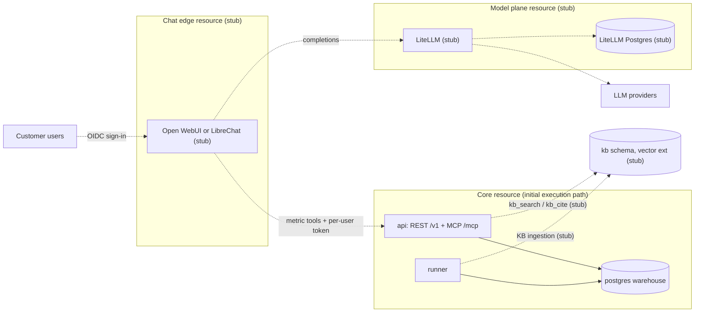

# Edge stubs: chat edge, model plane, knowledge plane

**Summary:** The chat edge (Variant A), the model plane (LiteLLM), and the knowledge plane (pgvector `kb_*` tools) are **stubs**. They are not on the initial execution path and not in Core's compose file (operator direction, Tucker, 2026-09-22). They are written now so Core honors their contracts from day one and turning one on later changes nothing in Core. The chat edge and the model plane each become their own Coolify resource on the tenant server when activated; the knowledge plane activates inside Core's existing services.

Everything here is **proposed** and a Phase G (design) artifact: nothing is built before the operator sign-off gate that opens the build phase (G8). Terms (Core, principal, access mode, row scope, edge, model plane, knowledge plane) are defined in [README.md](./README.md#terms-used-here).

## Why stubs are written before they are built

- **One invariant governs all three:** optional and swappable stubs (INV-12, [system-architecture.md](./system-architecture.md#invariants)). Turning a stub on changes no Core semantics, ACL, or MetricFlow definitions.
- **Core must already expose the seams:** `oidc` access mode, bearer auth on MCP tool discovery, `kb_*` stub endpoints, and a `vector`-capable warehouse image. Designing them now avoids a breaking change to the tool contract later.
- **The stubs must never widen Core's trust boundary:** no stub holds a warehouse credential (INV-2), and no stub answers a metric (INV-3). Stating the rules now keeps them out of reach of whichever product gets picked.

*Caption: solid edges are Core (in path); dashed edges and `(stub)` nodes are off the initial execution path. The KB schema lives in the warehouse cluster when activated.*

Per-service credentials and topology are owned by [deployment-coolify.md](./deployment-coolify.md); the sequence for a chat query is in [runtime-flows.md](./runtime-flows.md).

## (a) Chat edge, Variant A (stub)

**Purpose:** give customer users a chat UI whose metric answers come from Core. The edge is chrome; Core is the front door and bouncer that decides every answer ([access-control.md](./access-control.md)).

**Shape (proposed):** a separate Coolify resource on the tenant server (proposed P6 in [decisions-and-open-questions.md](./decisions-and-open-questions.md)). It calls Core at `${SERVICE_URL_API}/mcp` (or `/v1`), sends completions to the model plane, and never talks to the warehouse.

### Operator's v1 requirements (Tucker, 2026-09-22)

| Requirement | Who enforces it |
|---|---|
| Row-level metric scoping | Core, not the UI (row scope fails closed, CORE-ACC-06) |
| Per-group model and tool access | Edge (per-group model and tool access, STUB-EDGE-03) |
| Per-group document and knowledge access | Edge at retrieval (STUB-EDGE-04), plus Core's document filter if Core's KB is the source (STUB-KB-02) |
| SCIM provisioning and deprovisioning | Edge, from the customer IdP (STUB-EDGE-05) |
| At most 50 users per tenant over 12 to 24 months | Sizing input (STUB-EDGE-06) |
| White-label | Deferred, "probably, but not now"; a reassessment trigger (STUB-EDGE-06) |

### Identity contract Core already honors

- **The edge forwards a verifiable per-user credential** (an IdP-signed OIDC access token) to Core on MCP tool discovery **and** on every tool call (verifiable per-user credential, STUB-EDGE-02; bearer on every request, CORE-API-06).
- **Core validates it in `oidc` access mode:** issuer discovery, JWKS signature check, audience check, then maps a claim (default `sub` or `groups`) to a manifest principal (OIDC mode, CORE-ACC-11). Issuer and audience come from `NS_CORE_OIDC_ISSUER` and `NS_CORE_OIDC_AUDIENCE` ([.env.example](../../../compose/local-warehouse/.env.example)).
- **Spoofable identity headers alone are rejected.** A user id or email in a header the edge sets is not an identity Core accepts.
- **The token's audience must be Core.** The MCP authorization spec forbids a server from passing a token it received through to a downstream service (confused deputy), and binds tokens to a specific resource ([MCP authorization, 2025-06-18](https://modelcontextprotocol.io/specification/2025-06-18/basic/authorization)). The edge therefore needs a token minted for Core's audience, not its own session token.
- **The edge never holds a warehouse credential**; completions go to the model plane and metric tools go to Core directly (no warehouse credential at the edge, STUB-EDGE-07; INV-2).
- **Enabling the edge changes nothing in Core** except turning on `oidc` in the manifest `access` block (separate resource, STUB-EDGE-01; INV-12).

Principal mapping, the `oidc` mode itself, and the threat model are owned by [access-control.md](./access-control.md).

### Candidate pick: pending

- **Open WebUI** is the operator's hypothesis. **LibreChat** was the prior run's default ([build-vs-buy-chat-with-modeled-data.md](../../product/research/oss-agent-harness-chat-data-20260922/build-vs-buy-chat-with-modeled-data.md)).
- The build-vs-buy re-run against the v1 access requirements is **in progress** at [build-vs-buy-chat-surface-acl.md](../../product/research/oss-agent-harness-chat-data-20260922/build-vs-buy-chat-surface-acl.md). The pick is pending Tucker's stamp. This doc does not choose.
- Whichever wins must pass the identity contract above; a candidate that can only forward headers fails it.

### Activation checklist (chat edge)

- [ ] Build-vs-buy verdict stamped by Tucker; feature spec written under `docs/features/` (none exists today).
- [ ] Core `oidc` mode built and passing its acceptance check (CORE-ACC-11).
- [ ] Customer IdP chosen per tenant; issuer and audience set in Core's env; the edge obtains tokens with Core's audience.
- [ ] Claim-to-principal mapping and row scopes written in the tenant manifest; ACL smoke passes for each mapped group.
- [ ] Negative test: a call carrying only identity headers is rejected (STUB-EDGE-02).
- [ ] SCIM deprovisioning drill passes; edge env holds no Postgres DSN (STUB-EDGE-05, STUB-EDGE-07).
- [ ] Decision on who owns documents: the edge's built-in RAG or Core's KB plane (open question below).

## (b) Model plane, LiteLLM (stub)

**Purpose:** one OpenAI-compatible gateway for LLM completions, with per-key budgets and spend tracking (budgets and spend, STUB-MODEL-04). Core does not call it, except possibly for KB embeddings if that path is chosen (STUB-KB-05).

**Shape (proposed):** a separate Coolify resource on the tenant server with its **own Postgres** for keys and spend, never the warehouse cluster (own Postgres, STUB-MODEL-01; INV-2). Coolify ships a one-click LiteLLM template (LiteLLM + Postgres + Redis, port 4000) that is a usable starting point ([Coolify litellm template](https://github.com/coollabsio/coolify/blob/main/templates/compose/litellm.yaml)).

**Contract Core already honors:** Core's MCP is reached directly by clients. It is **never registered in LiteLLM's MCP gateway** (STUB-MODEL-02; every metric read through one enforcement point, INV-1).

### Verified facts

| Fact | Consequence | Source |
|---|---|---|
| Repo root is MIT; everything under `enterprise/` is a commercial license that requires a BerriAI Enterprise license for production use. | Use MIT core features only; no enterprise features without a contract (STUB-MODEL-03). | [LICENSE](https://github.com/BerriAI/litellm/blob/main/LICENSE), [enterprise/LICENSE.md](https://github.com/BerriAI/litellm/blob/main/enterprise/LICENSE.md) |
| MIT core already covers virtual keys, per-key/user/team budgets, spend tracking, fallbacks. SSO/RBAC, tag budgets, and detailed audit logs are enterprise. | Per-tenant budgets need no license. | [LiteLLM enterprise](https://docs.litellm.ai/docs/enterprise), [virtual keys](https://docs.litellm.ai/docs/proxy/virtual_keys) |
| Production docs recommend an exact version tag over `main-stable` or `latest`. | Pin an exact `main-vX.Y.Z-stable` tag (STUB-MODEL-03). | [LiteLLM deploy](https://docs.litellm.ai/docs/proxy/deploy) |
| Keys, spend, and budgets are Postgres-backed (`DATABASE_URL`). | It needs its own database; the plain image now includes Postgres support. | [LiteLLM deploy](https://docs.litellm.ai/docs/proxy/deploy) |
| If `UI_PASSWORD` is unset the master key works as the admin password; `general_settings.disable_env_credential_login: true` turns env-credential login off. | Disable env-credential admin login once real auth exists (STUB-MODEL-03). | [LiteLLM UI](https://docs.litellm.ai/docs/proxy/ui), [security best practices](https://docs.litellm.ai/docs/proxy/security_best_practices) |
| LiteLLM's MCP gateway aggregates upstream MCP servers behind its own virtual-key auth. | Registering Core there would route metric tool traffic through the model gateway and replace per-user identity with a LiteLLM key. Do not (STUB-MODEL-02). | [LiteLLM MCP](https://docs.litellm.ai/docs/mcp) |

### Activation checklist (model plane)

- [ ] Feature spec written; answer recorded on whether any enterprise feature is needed (open question in [decisions-and-open-questions.md](./decisions-and-open-questions.md)).
- [ ] Exact tag pinned; its Postgres connectivity verified against that tag.
- [ ] Own Postgres provisioned in the LiteLLM resource; its env has no warehouse DSN (STUB-MODEL-01).
- [ ] Master key, salt key, and provider keys set as runtime env in Coolify (INV-11); salt key recorded as set-once.
- [ ] Env-credential admin login disabled; admin UI not exposed publicly unless required.
- [ ] LiteLLM config lists no Core MCP upstream (STUB-MODEL-02).
- [ ] Budget exhaustion blocks only the exhausted key (STUB-MODEL-04).

## (c) Knowledge plane, pgvector `kb_*` tools (stub)

**Purpose:** let users search and cite tenant documents. Knowledge content may describe metrics; it never answers them. Numbers come only from `mf_query` (knowledge never answers a metric, STUB-KB-04; INV-3).

**Shape (proposed):** not a separate resource. When activated: the `vector` extension and a `kb` schema in the warehouse cluster (STUB-KB-01), an ingestion job in the runner reading `kb/` from the semantics repo, and `kb_search` / `kb_cite` on the same API through the same enforcement with a per-principal document filter (STUB-KB-02). The endpoint shapes are stubbed in [interface-contracts.md](./interface-contracts.md).

**Contract Core already honors:** the warehouse image is `pgvector/pgvector:0.8.6-pg16` from day one ([docker-compose.yml](../../../compose/local-warehouse/docker-compose.yml)), with the extension **not** created until activation (proposed P9).

### Verified facts

| Fact | Consequence | Source |
|---|---|---|
| The pgvector image tag must match the Postgres major version; binaries for one major do not load on another. | Keep the `-pg16` suffix in step with the warehouse major. A major upgrade needs dump/restore or `pg_upgrade`, not an image swap. | [pgvector image tags](https://hub.docker.com/r/pgvector/pgvector/tags) |
| `CREATE EXTENSION vector` is per database, not per cluster. | Activation runs it in the tenant database (`PG_DATABASE`) as part of warehouse bootstrap. | [pgvector image tags](https://hub.docker.com/r/pgvector/pgvector/tags) |
| The allowlist gate covers models, seeds, and dashboard tables only. | Knowledge content has **no allowlist gate today**; a knowledge allowlist equivalent is a prerequisite (STUB-KB-03). | [allowlist-gate.md](../../features/allowlist-gate.md) |

### Activation checklist (knowledge plane)

- [ ] Knowledge allowlist equivalent designed and enforced: an unlisted collection fails ingestion (STUB-KB-03).
- [ ] Embedding path chosen by Tucker, local model or via the model plane, and recorded in the document it governs (STUB-KB-05).
- [ ] Per-principal document grants added to the manifest (a schema change; `manifest/schema.json` has no such field today).
- [ ] `kb_*` tools pass the same ACL smoke as metric tools (STUB-KB-02).
- [ ] Eval: metric questions route to `mf_query`, never to `kb_search` (STUB-KB-04).
- [ ] RAM and storage headroom confirmed on the tenant VM size.

## Variant B: Core plus Onyx/RAGFlow dual plane (later option)

- **What it is:** a connector-heavy document plane (Onyx, optionally RAGFlow) beside Core, for an org-document product. The chat edge gets a metric tool (Core) and a document retrieval tool (Onyx). Origin: [chat-with-modeled-data.md](../chat-with-modeled-data.md) (superseded by this doc set).
- **Status:** out of scope; recorded only as a later option.
- **Main risk, dual ACL:** documents are permissioned in Onyx, metrics in Core. Two ACL systems can drift, and an answer that blends them is only as safe as the weaker one. Mitigation from the research: separate tool names and product copy, and no silent merge of document answers into "the number." Onyx never becomes a metric source of truth (INV-3).
- **Open:** timing, Onyx CE versus EE (permission sync is an EE feature per the research pack), and whether it fits beside the local warehouse on one VM.

## Hermes: operator-only sidecar reference

- Research positions Hermes Agent as an operator or Narrowstack-staff sidecar pattern (skills, MCP, bring-your-own model), **not** a customer surface and not part of any tenant resource.
- Core agent runtime (ADR-001, [decisions.md](../decisions.md#adr-001--core-agent-runtime)) is still **Proposed** and still says "Keep Hermes Agent for v0." Whether to restamp it to operator-sidecar wording is **open** for Tucker; its revisit trigger includes 2026-11-17.
- Any Hermes use goes through Core's API with a principal token like every other client (INV-1).

## Open questions (stubs only)

The deduplicated list is owned by [decisions-and-open-questions.md](./decisions-and-open-questions.md). Raised here:

1. **Chat edge pick:** Open WebUI or LibreChat; pending the re-run and Tucker's stamp.
2. **Who owns documents for the edge:** the chat products ship their own retrieval (Coolify's LibreChat template bundles its own vector database and RAG API, [template](https://github.com/coollabsio/coolify/blob/main/templates/compose/librechat.yaml)). Using it creates a second document plane beside Core's KB with its own ACL. Pick one.
3. **Edge-to-Core and edge-to-LiteLLM transport:** each Coolify resource gets its own network ([Coolify networking](https://next.coolify.io/docs/core/networking-in-coolify)). Call Core via its public URL (as `.env.example` assumes) or join a predefined network? Same for the model plane.
4. **Claim mapping granularity:** one principal per user or per IdP group? The manifest `principals[].tier` enum (`leadership`, `team`, `agent`) has no end-user tier today.
5. **One IdP across Coolify, Core, and the edge,** or separate per layer. Core stays IdP-agnostic either way (Core runs no identity provider, operator direction).
6. **Sizing:** Core alone fits `standard-4x16`; edge plus LiteLLM (plus Redis) headroom on the same VM is unmeasured.
