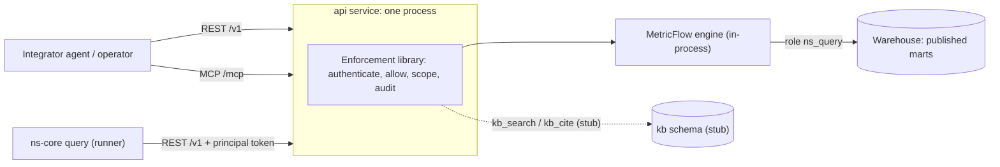

# Core runtime: interface contracts

**Summary:** Core has one front door: the Modeling API process serves REST at `/v1` and MCP at `/mcp` through one enforcement library, and the `ns-core` CLI reaches metrics only through that API. This doc fixes the *shapes* of those surfaces, the on-VM state files, the env contract, and the proposed manifest additions. Everything here is **proposed** and is a contract stub, not an implementation; building it is Phase B work, which waits for the operator sign-off gate (G8).

Terms (Core, principal, access mode, open mode, row scope, generation, green-check) are defined in [README.md](./README.md#terms-used-here). Invariants are owned by [system-architecture.md](./system-architecture.md#invariants). Access semantics (modes, tokens, row scope rules, audit) are owned by [access-control.md](./access-control.md); this doc only gives their wire shapes.

## Surfaces at a glance



*Caption: REST, MCP, and the CLI converge on one enforcement library before MetricFlow; the knowledge-plane tools are a dashed stub.*

## Versioning

- **Three independently versioned interfaces** (canon, [packaging.md](../packaging.md)): the tool contract (this doc), the semantic contract (the tenant's MetricFlow definitions, versioned by `semantics_ref`), and the telemetry protocol ([telemetry-protocol.md](../telemetry-protocol.md)). A new generation or semantics ref never bumps the tool contract.
- **Tool contract version:** path prefix `/v1` and `tool_contract: 1` in every successful response body; a breaking change ships as a new version (contract versioned, CORE-API-09).
- **Response envelope** (every success body): `tool_contract`, `generation`, `semantics_ref`, `access_mode`. In open mode every response, errors included, also carries the header `X-NS-Core-Access-Mode: open` (open mode is loud, CORE-ACC-02).

## REST endpoints

Auth column: "bearer" means `Authorization: Bearer <token>` is required in `token` / `oidc` mode and ignored in open mode.

| Method + path | Canon tool | Auth | Returns |
|---|---|---|---|
| `GET /v1/metrics` | `list_metrics` | bearer | Allowed metrics only: name, label, description, type, dimensions, entities, sensitivity tier, `row_scoped` flag. Denied names omitted (CORE-API-02) |
| `GET /v1/manifest?metrics=a,b` | `get_manifest` | bearer | Semantic-manifest slice for allowed metrics only (CORE-API-03) |
| `POST /v1/query` | `mf_query` | bearer | `columns`, `rows`, `sql`, `applied_scope[]`, `query_id`, `truncated` + envelope (CORE-API-04) |
| `GET /v1/whoami` | none | bearer | Principal id, access mode, grant summary (metric patterns, row scope) |
| `GET /v1/status` | none | bearer unless open | Tenant, Core version, semantics ref + SHA, active generation, last gate result, access mode |
| `GET /healthz` | none | none | Liveness status word only (CORE-API-08) |
| `GET /readyz` | none | none | Readiness status word only: generation loaded and post-load ACL self-test passed |
| `POST /v1/kb/search`, `GET /v1/kb/docs/{id}` | `kb_search`, `kb_cite` | bearer | **Stub.** Not exposed until the knowledge plane activates (see [edge-stubs.md](./edge-stubs.md)) |

### `mf_query` request and response (illustrative)

Request body fields: `metrics[]` (required), `group_by[]`, `where[]`, `order_by[]`, `limit`, `time_start`, `time_end`.

```json
{
  "metrics": ["revenue"],
  "group_by": ["metric_time__month", "customer__region"],
  "where": ["{{ Dimension('customer__segment') }} = 'enterprise'"],
  "order_by": ["metric_time__month"],
  "time_start": "2026-07-01",
  "time_end": "2026-09-30",
  "limit": 100
}
```

Response for a principal whose row scope is `customer__region in [EMEA]`:

```json
{
  "tool_contract": 1,
  "generation": 7,
  "semantics_ref": "v0.1.0",
  "access_mode": "token",
  "query_id": "q_7f3c2a",
  "columns": ["metric_time__month", "customer__region", "revenue"],
  "rows": [
    ["2026-07-01", "EMEA", 182340.00],
    ["2026-08-01", "EMEA", 190115.50],
    ["2026-09-01", "EMEA", 201870.25]
  ],
  "truncated": false,
  "applied_scope": [
    {"dimension": "customer__region", "values": ["EMEA"], "source": "principal.row_scope"}
  ],
  "sql": "SELECT ... FROM marts__g7.fct_revenue ... WHERE customer_segment = 'enterprise' AND customer_region IN ('EMEA') ..."
}
```

- `sql` is the compiled SQL actually executed, scope filters included; `generation` names the build that produced the number (every answer shows its query, INV-4).
- Row-scope filters are ANDed into the query and appear in both `applied_scope` and `sql` (row scope fails closed, CORE-ACC-06).
- Open question: whether `where[]` takes raw MetricFlow filter strings (as above) or a structured `{dimension, op, values}` form. The structured form is easier to validate against row scope.

## Error model

Every error body is exactly `{"error": "<code>", "query_id": "<id>"}`. Every call, denials included, writes an audit row (CORE-ACC-08). Denials leak nothing (INV-5).

| Status | When | Body may contain | Body must not contain |
|---|---|---|---|
| 400 | Malformed body, unknown request field, wrong type, `limit` above the maximum | `error` code, `query_id` | Any hint about whether a metric exists |
| 401 | Missing, malformed, expired, revoked, or unknown credential in `token` / `oidc` mode | `error`, `query_id` (+ standard `WWW-Authenticate: Bearer` header) | Which of those reasons applied |
| 403 | Metric not allowed, not shipped, or not reachable by a scope dimension | `error`, `query_id` | Value, row count, SQL, allowed alternatives, principal's grants (CORE-API-05) |
| 409 | No active generation to answer from | `error`, `query_id` | Gate report detail |
| 429 | Rate limited. **Stub:** no limiter in the first deploy | `error`, `query_id` | Quota internals |
| 503 | Not ready: generation loading or self-test failing | `error`, `query_id` | Instance detail |

Proposed: an **unknown** metric name returns the same 403 body as a **denied** one, so callers cannot enumerate denied names by probing.

## MCP contract

- **Transport:** streamable HTTP at `/mcp`, mounted in the same process as REST (one service serves REST + MCP, proposed; CORE-API-01).
- **Auth:** `Authorization: Bearer <token>` on **every** HTTP request, including `initialize` and `tools/list`. Unauthenticated discovery returns HTTP 401 in `token` mode (CORE-API-06). Core never forwards a caller's token downstream, per the MCP authorization spec ([2025-06-18](https://modelcontextprotocol.io/specification/2025-06-18/basic/authorization)).
- **Tools** mirror REST inputs and outputs exactly. Each result carries structured content matching the REST body plus a text rendering that includes the SQL.

| Tool | Input fields | Output (structured content) |
|---|---|---|
| `list_metrics` | none | Same as `GET /v1/metrics` |
| `get_manifest` | `metrics[]` | Same as `GET /v1/manifest` |
| `mf_query` | `metrics[]`, `group_by[]`, `where[]`, `order_by[]`, `limit`, `time_start`, `time_end` | Same as `POST /v1/query` |
| `kb_search` (stub) | query text, optional collection | Excerpts filtered by the principal's document grant (STUB-KB-02) |
| `kb_cite` (stub) | document id | One cited excerpt, same filter |

- Tool-level denials come back as a tool result flagged as an error whose structured content is the same `{error, query_id}` body as REST. Transport-level auth failures stay HTTP 401.
- Stub tools are not registered in `tools/list` until the knowledge plane activates (proposed).
- **Open question, SDK major version:** the official Python SDK (`mcp`) shipped v2.0.0 on 2026-07-28 with breaking API removals from 1.x ([PyPI](https://pypi.org/project/mcp/2.0.0a1/)). Pin `>=1.28,<2` or adopt 2.x at Phase B build time. Either way, mounting into the host ASGI app needs the host lifespan to run the MCP session manager ([SDK ASGI docs](https://py.sdk.modelcontextprotocol.io/run/asgi/), [issue 1367](https://github.com/modelcontextprotocol/python-sdk/issues/1367)).
- **Open question, MCP auth discovery:** whether Core also serves OAuth protected-resource metadata (RFC 9728) for `oidc` mode, or stays plain bearer validation.

## CLI contract (`ns-core`)

The CLI lives in the `runner` container (`docker compose exec runner ns-core <cmd>`; in Coolify, the resource terminal). Ops commands run with **operator authority**: whoever can exec into the container already has Coolify-level trust. **Metric reads go through the API** with a principal token and never touch the warehouse directly (every metric read goes through the API, INV-1; CORE-API-07). Existing commands are stubs today in [scripts/ns-core](../../../scripts/ns-core), specified in [ns-core-cli.md](../../features/ns-core-cli.md).

| Command | Status | What it does | Runs with |
|---|---|---|---|
| `status [--healthcheck]` | existing stub | Pins, active generation, last gate, access mode (red banner when open), control-plane state (CORE-OPS-01). `--healthcheck` is the runner's compose healthcheck | operator; reads state files |
| `deploy` | existing stub (takes a manifest path) | Run green-check. Proposed: inputs come from env pins (`NS_SEMANTICS_REF`, `NS_MANIFEST_PATH`) instead of a path argument | operator; per-role DB credentials |
| `rollback` | existing stub (wraps `deploy/rollback.sh`) | Restore last-good. Proposed: with blue/green generations this becomes `generations activate <N-1>` | operator |
| `grants` | existing stub | Show and change telemetry grants per the telemetry protocol | operator |
| `acl list` | existing stub | Effective permissions per manifest principal (metric names and row scope, never values) | operator |
| `backup` / `restore` | existing stub | Core snapshot to `BACKUP_TARGET`; scripted restore (CORE-OPS-02, CORE-OPS-03) | operator; superuser for restore |
| `bootstrap` | proposed | Container entrypoint: green-check for pinned inputs or keep last-good, then hand off to the cron runner | operator (automatic) |
| `refresh` | proposed | Run a scheduled refresh now; never changes pins | operator |
| `generations list \| show <N> \| activate <N>` | proposed | Inspect retained generations; switch the active one (CORE-GEN-07) | operator |
| `access setup` | proposed | Verify access mode, run ACL smoke, issue the first operator token (CORE-ACC-07) | operator |
| `access status` | proposed | Current mode, principals, token counts | operator |
| `access token issue <principal> [--ttl 30d] \| revoke <id> \| list` | proposed | Issue (shown once), revoke (immediate), list token metadata (CORE-ACC-04) | operator; writes `ns_core` token hashes |
| `query` | proposed | Ask a metric question through the API | **principal token**, via API only |
| audit export (name not fixed) | proposed | Export the audit log without a support ticket (CORE-ACC-08) | operator |

## State files

On-VM runtime truth, not in git. The `state` volume is mounted at `/var/lib/ns-core/state` (read-write in `runner`, read-only in `api`); per-generation dbt artifacts live in the `artifacts` volume at `/var/lib/ns-core/artifacts/<N>/` (`manifest.json`, `semantic_manifest.json`). Canon places `active-manifest.json` under `deploy/`; moving it to the state volume is a proposed canon delta. Only `active-manifest.json` has fixed fields (brief); the other file names below are illustrative.

| File | Written by | Read by | Purpose |
|---|---|---|---|
| `state/active-manifest.json` | runner, at publish | api (poll + hot-swap, CORE-API-10), `ns-core status` | Which generation is live and why (CORE-GEN-05) |
| `state/generations/<N>.json` | runner | `ns-core generations` | One record per generation, retained per `NS_GENERATIONS_RETAINED` |
| `state/gate-reports/<N>-<started_at>.json` | runner, every gate run incl. failures | `ns-core status`, operators | Stage-by-stage result (CORE-GEN-01, CORE-OPS-06) |

`active-manifest.json` (illustrative):

```json
{
  "tenant_id": "example",
  "generation": 7,
  "previous_generation": 6,
  "core_version": "v0.3.0",
  "semantics_ref": "v0.1.0",
  "semantics_sha": "3f9c1e7",
  "manifest_sha256": "9b2e...c41a",
  "published_schema": "marts__g7",
  "access_mode": "token",
  "gate": {
    "result": "pass",
    "stages": [{"n": 6, "name": "allowlist", "result": "pass"}],
    "started_at": "2026-09-22T02:00:05Z",
    "finished_at": "2026-09-22T02:14:41Z"
  }
}
```

Gate report (illustrative, one failed refresh that kept the last-good generation):

```json
{
  "kind": "refresh",
  "attempted_generation": 8,
  "result": "fail",
  "outcome": "kept_last_good",
  "active_generation": 7,
  "warnings": [],
  "stages": [
    {"n": 5, "name": "pipelines_dbt", "result": "pass", "duration_s": 512},
    {"n": 8, "name": "tie_out", "result": "fail", "detail": "revenue: source 190115.50 vs shipped 190015.50"}
  ]
}
```

Generation record (illustrative): `{"generation": 7, "status": "active", "schemas": ["staging__g7", "marts__g7"], "semantics_sha": "3f9c1e7", "core_version": "v0.3.0", "manifest_sha256": "9b2e...c41a", "published_at": "2026-09-22T02:14:41Z", "gate_report": "gate-reports/7-2026-09-22T02:00:05Z.json"}`. `status` is one of `active`, `retained`, `failed`, `dropped`.

In open mode the gate report's `warnings` carries an open-mode warning; it does not fail the gate (CORE-ACC-02).

## Env contract

[compose/local-warehouse/.env.example](../../../compose/local-warehouse/.env.example) is canonical for names, defaults, and tags; how to enter them in Coolify and which credentials each service receives is owned by [deployment-coolify.md](./deployment-coolify.md). Secrets are runtime env values only (INV-11; CORE-SEC-02).

| Group | Variable | Meaning | Consumed by |
|---|---|---|---|
| Instance | `NS_TENANT_ID` | Runtime slug; must equal manifest `tenant_id` | runner, api |
| Instance | `NS_CORE_VERSION` | Core release tag; image tags follow it | runner, api |
| Instance | `NS_LOG_LEVEL` | `debug`, `info`, `warn` | runner, api |
| Semantics | `NS_SEMANTICS_REPO` | SSH clone URL of the tenant semantics repo | runner |
| Semantics | `NS_SEMANTICS_REF` | Tag or SHA; must equal manifest `semantics_ref` | runner |
| Semantics | `NS_SEMANTICS_DEPLOY_KEY_B64` | Base64 read-only deploy key, one repo (CORE-PIPE-01) | runner |
| Semantics | `NS_MANIFEST_PATH` | Manifest path in the semantics repo | runner |
| Warehouse | `PG_DATABASE` | Database name | postgres, runner, api |
| Warehouse | `PG_SUPERUSER` | Superuser name | postgres, runner |
| Warehouse | `SERVICE_PASSWORD_64_POSTGRES` | Superuser password (bootstrap only); `PG_SUPERUSER_PASSWORD` in runner | postgres, runner |
| Warehouse | `SERVICE_PASSWORD_64_LOADER` | `ns_loader`; `DLT_PG_PASSWORD` inside | runner |
| Warehouse | `SERVICE_PASSWORD_64_TRANSFORMER` | `ns_transformer`; `DBT_PG_PASSWORD` inside | runner |
| Warehouse | `SERVICE_PASSWORD_64_QUERY` | `ns_query`; `MF_PG_PASSWORD` inside | runner, api |
| Warehouse | `SERVICE_PASSWORD_64_APISTATE` | `ns_api`; `API_RO_PG_PASSWORD` inside | runner, api |
| Access | `SERVICE_PASSWORD_64_TOKENPEPPER` | HMAC pepper for token hashes; `NS_CORE_TOKEN_PEPPER` inside | api |
| Access | `NS_CORE_TOKEN_MAX_TTL_DAYS` | Longest token lifetime (default 90) | api |
| Access | `NS_CORE_OIDC_ISSUER`, `NS_CORE_OIDC_AUDIENCE` | **Stub:** `oidc` mode issuer and audience (CORE-ACC-11) | api |
| Public URL | `SERVICE_URL_API` | Coolify-generated URL of the `api` domain (`https://api.<tenant-domain>`); `NS_CORE_PUBLIC_URL` inside. `SERVICE_URL_API_8080` is declared bare on `api` to request the route | api |
| Runtime | `NS_REFRESH_SCHEDULE` | Refresh cron (default every 6 hours) | runner |
| Runtime | `NS_AUTO_ROLLBACK` | 1 = keep or restore last-good on gate failure (CORE-GEN-06) | runner |
| Runtime | `NS_GENERATIONS_RETAINED` | Published generations kept (default 2) | runner |
| Backup | `BACKUP_TARGET` | S3-compatible URL; manifest `backup.target_env` | runner |
| Backup | `BACKUP_S3_ACCESS_KEY_ID`, `BACKUP_S3_SECRET_ACCESS_KEY` | Backup target credentials | runner |
| Backup | `NS_BACKUP_SCHEDULE` | Core snapshot cron | runner |
| Telemetry | `NS_CONTROL_PLANE_ENABLED` | Outbound, consent-gated control plane; default `false` | runner |
| Sources | `SOURCES__<SOURCE>__<KEY>` | dlt credentials, listed one by one per enabled pipeline (CORE-PIPE-06) | runner |
| Stub | chat edge, model plane, KB embeddings | Separate Coolify resources with their own env; never added here | none in Core |

Set by the compose file, not by operators: `PG_HOST`, `PG_PORT`, `NS_STATE_DIR`, `NS_ARTIFACTS_DIR`, `NS_SEMANTICS_DIR`, `NS_CORE_API_URL` (runner's internal route to the API for `ns-core query`).

## Manifest deltas (proposed)

Access config belongs in the manifest so a second instance reproduces from its config commit (CORE-ACC-10). [manifest/schema.json](../../../manifest/schema.json) is `additionalProperties: false` at the top level and inside `principals[]`, so `access` and `row_scope` are **rejected today** and need a schema change before any manifest uses them.

```yaml
# illustrative, proposed
access:
  mode: [token]          # open | token | oidc, or a list; block absent = open mode
  oidc:                  # stub, needed when the chat edge lands
    principal_claim: groups
principals:
  - id: example-admin
    tier: leadership
    metrics: ["*"]
  - id: example-emea
    tier: team
    metrics: ["revenue_*"]
    row_scope:
      - dimension: customer__region
        values: [EMEA]
secrets_refs:
  dlt_pg_password: DLT_PG_PASSWORD
  dbt_pg_password: DBT_PG_PASSWORD
  mf_pg_password: MF_PG_PASSWORD
  api_ro_pg_password: API_RO_PG_PASSWORD
  # agent_pg_password: retired (proposed); agents use principal tokens, never a DB credential (INV-2)
```

- `row_scope`: list of `{dimension, values}` on MetricFlow dimensions or entities; semantics in [access-control.md](./access-control.md).
- Retiring `agent_pg_password`: `secrets_refs` is an open map in the schema, so this is an edit to the example manifest and to [metric-acl.md](../../features/metric-acl.md)'s per-role list, not a schema change.
- The `oidc` claim-to-principal mapping field names are not fixed (open question).

## Compatibility rules

Within `tool_contract: 1` (no version bump):
- Add a response field, an optional request field whose default keeps current behavior, a new endpoint, or a new tool. Clients must ignore unknown response fields.
- Add an `error` code only for a new condition; existing conditions keep their status and code.

Requires `tool_contract: 2` and a `/v2` path served beside `/v1`:
- Remove or rename a field, change a type, make an optional field required, or change the meaning of an existing status code. The side-by-side window is an open question.

Always, whatever the version:
- A new tool goes through the enforcement library and writes audit rows (INV-1). Only `mf_query` returns metric numbers; KB tools may describe metrics, never answer them (MetricFlow is the only metric source, INV-3).
- MCP and REST change together: a field added to one is added to the other in the same release (CORE-API-06).

## Open questions

Owned by [decisions-and-open-questions.md](./decisions-and-open-questions.md); raised here:
- `where[]` format: raw MetricFlow filter strings vs structured filters.
- MCP SDK 1.x vs 2.x; OAuth protected-resource metadata for `oidc` mode.
- How principals and row scope reach the `api` service, which mounts only `artifacts` and `state` (for example a validated manifest copy per generation).
- Which principal the first operator token from `access setup` belongs to; the schema's `tier` enum has no operator value.
- Which principals may call `GET /v1/status`.
- State file names beyond `active-manifest.json`; audit export command name; `/v2` side-by-side window.
