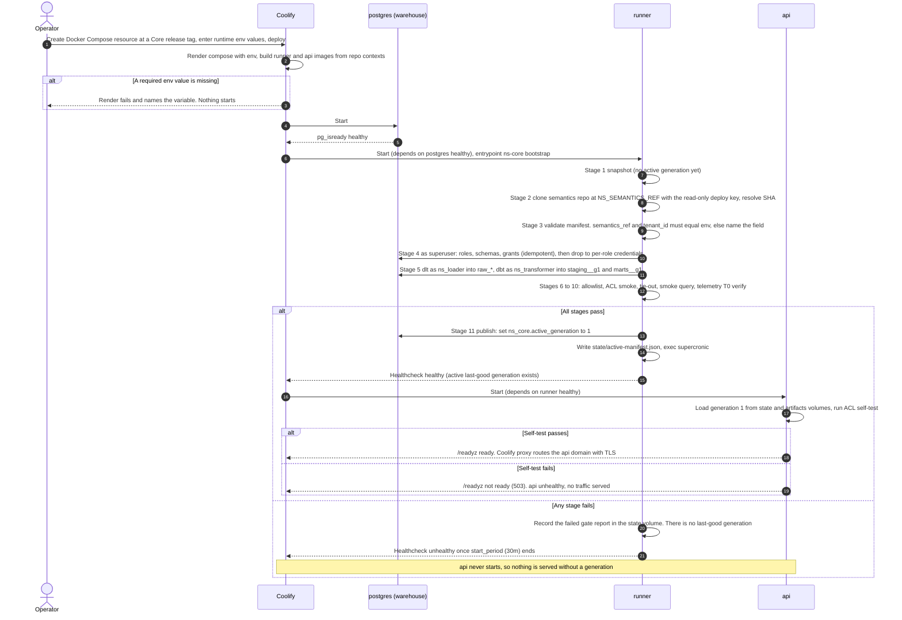
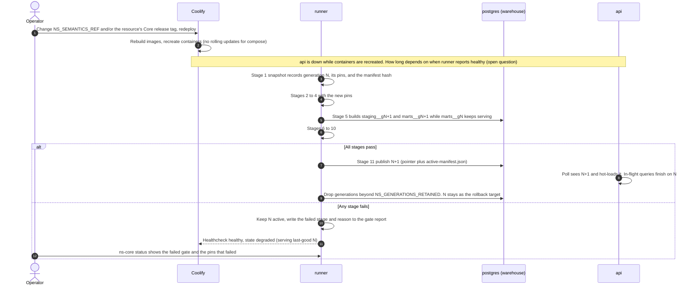
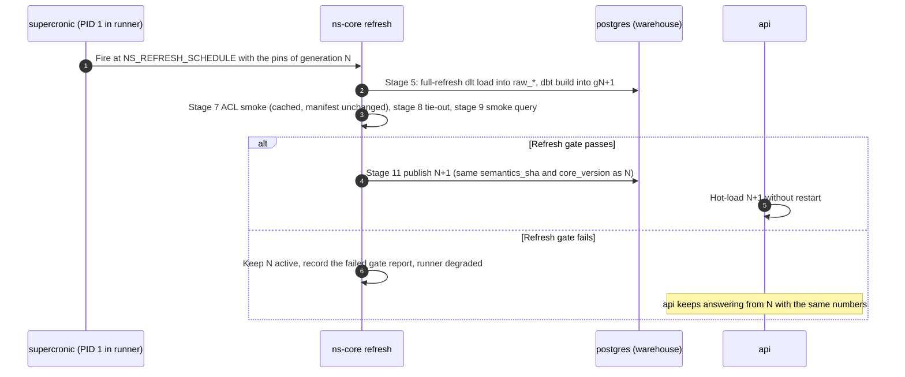
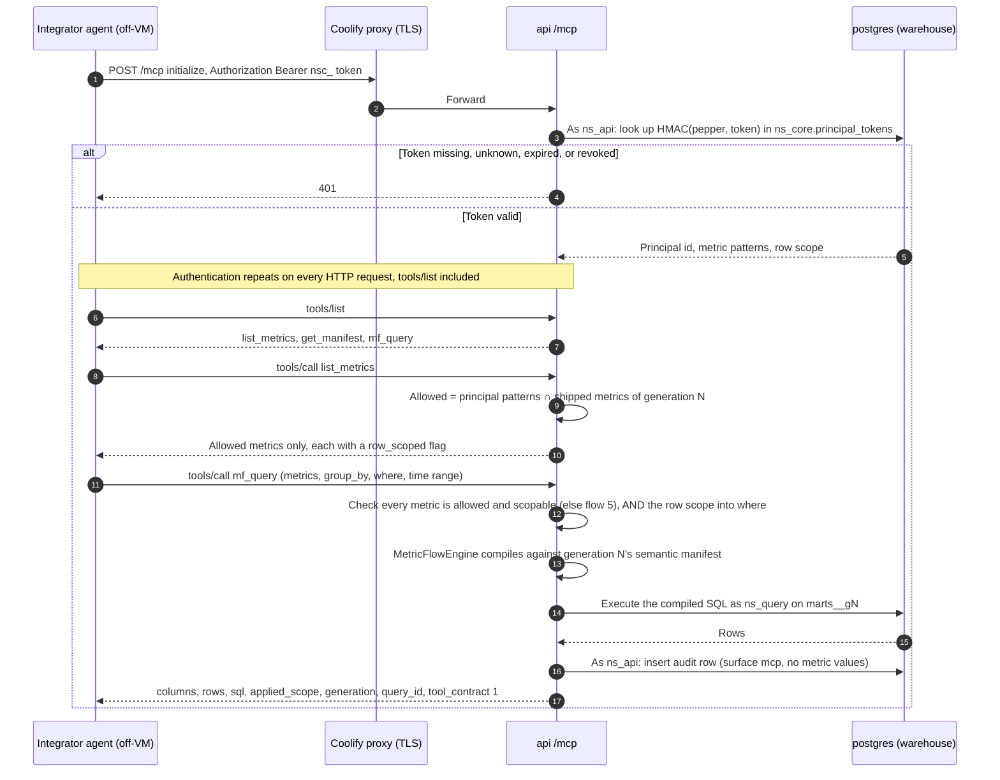
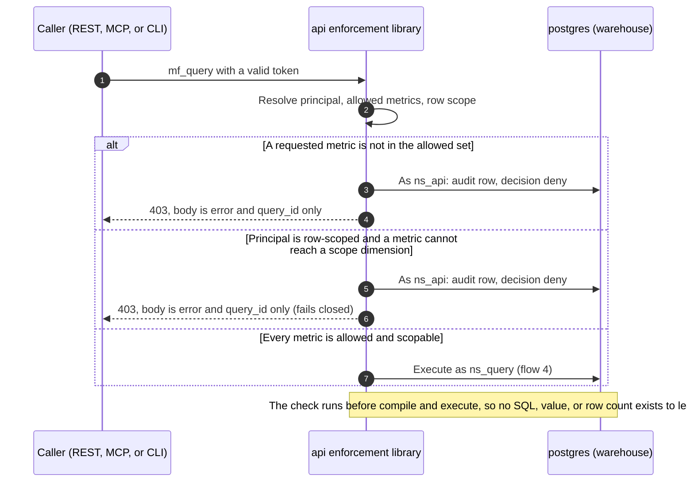
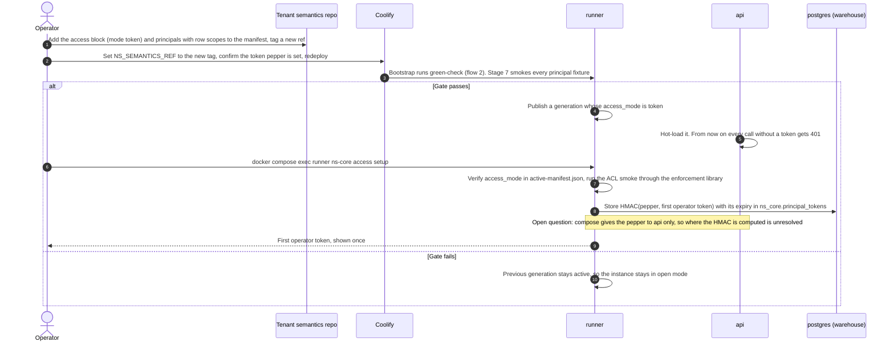
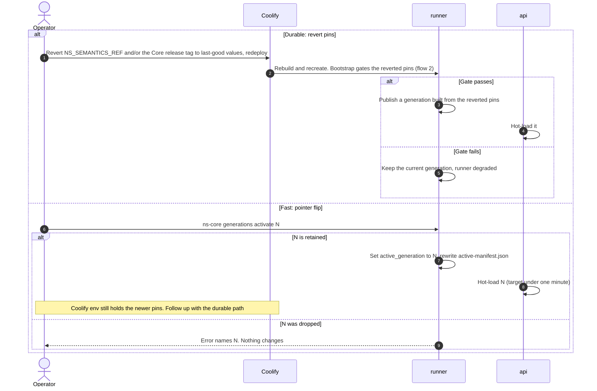
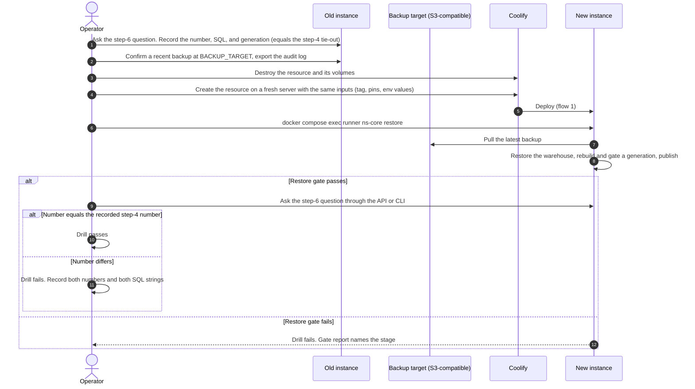
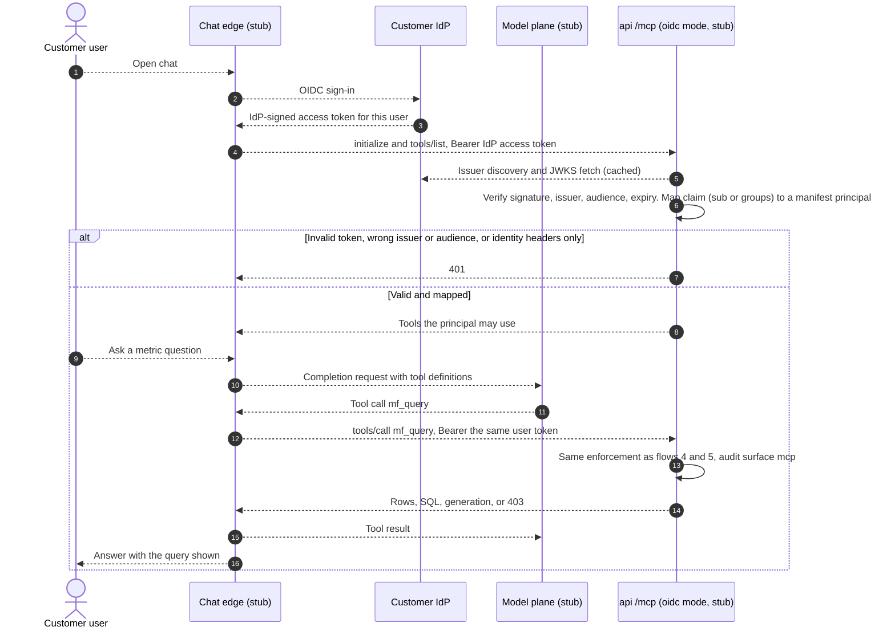
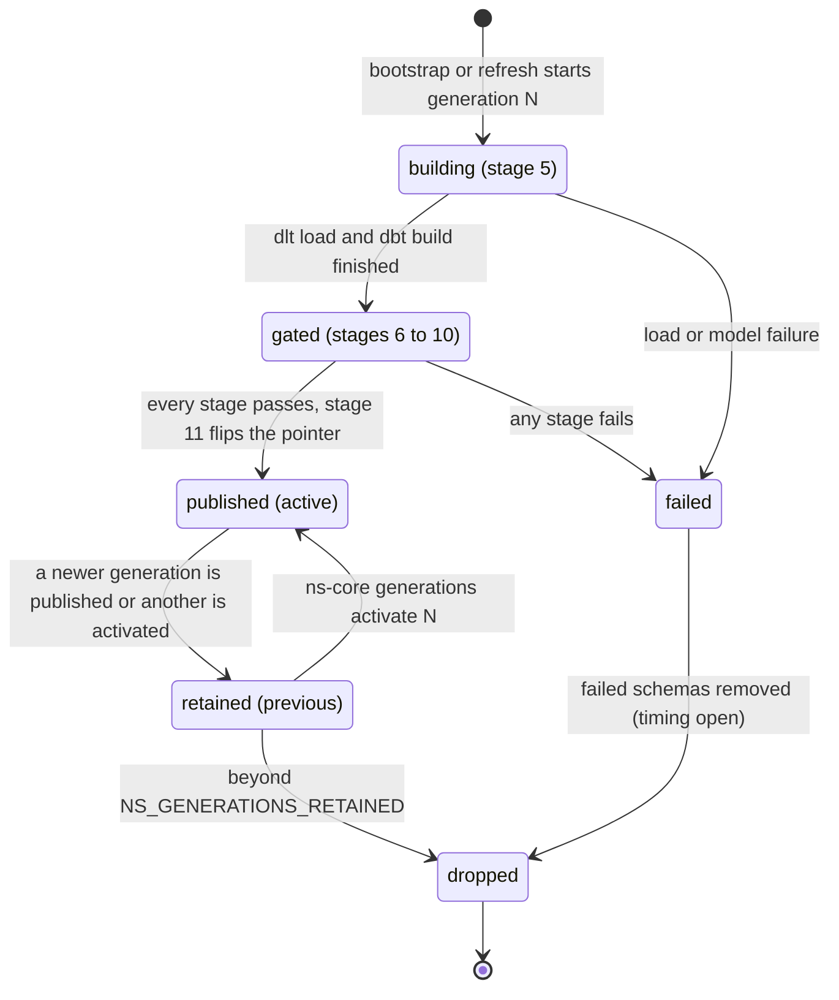

# Core runtime — runtime flows

**Summary:** How Core behaves at runtime, as sequence diagrams: deploy, redeploy, refresh, query, deny, access setup, rollback, and restore. Flows 1 to 8 are on the initial execution path. Flow 9 (chat edge) is a **stub** and is not part of the first deployment. Every flow is **proposed** and describes Phase B (build) behavior, which waits for operator sign-off G8 ([wave-review-gate.md](../../process/wave-review-gate.md)).

## How to read these flows

- Terms (Core, principal, access mode, generation, green-check, row scope) are defined in [README.md](./README.md#terms-used-here). Invariants (INV-n) live in [system-architecture.md](./system-architecture.md#invariants). Requirement IDs come from [requirements.md](./requirements.md).
- Services match the compose file ([docker-compose.yml](../../../compose/local-warehouse/docker-compose.yml)): `postgres` (the warehouse), `runner`, `api`. Env names match [.env.example](../../../compose/local-warehouse/.env.example).
- Green-check stage numbers (1 to 11) follow the table in [deployment-coolify.md](./deployment-coolify.md). State file fields are owned by [interface-contracts.md](./interface-contracts.md#state-files). Enforcement rules are owned by [access-control.md](./access-control.md).
- `alt` / `else` blocks are failure branches. Dashed arrows mark stub surfaces.

## 1. First deploy on Coolify

*A fresh tenant server goes from an empty Coolify resource to an API serving generation 1, or to no API at all.*

**Exercises:** three-input instance (CORE-DEP-01) · one compose resource (CORE-DEP-02) · startup order (CORE-DEP-05) · loud input failures (CORE-DEP-06) · images built on deploy (CORE-DEP-07) · read-only semantics clone (CORE-PIPE-01) · dlt load (CORE-PIPE-02) · dbt build (CORE-PIPE-03) · green-check in order (CORE-GEN-01) · allowlist (CORE-GEN-02) · tie-out (CORE-GEN-03) · ACL smoke (CORE-GEN-04) · atomic publish (CORE-GEN-05) · rollback-first (CORE-GEN-06) · health endpoints (CORE-API-08) · per-role credentials (CORE-ACC-09) · no host ports (CORE-SEC-01) · control plane off (CORE-TEL-01).

- Coolify builds `build:` services from its own clone of the Core repo ([Coolify compose build pack](https://coolify.io/docs/applications/build-packs/docker-compose)). The tenant semantics repo is cloned by the runner at stage 2, not by Coolify.
- Recovery from a failed first deploy: fix the input the gate report names, then redeploy. The runner container keeps running while unhealthy, so `ns-core status` works in the resource terminal.

## 2. Redeploy with a pin change

*An upgrade (new `NS_SEMANTICS_REF` or Core release tag) publishes generation N+1, or leaves N active and says why.*

**Exercises:** upgrade by pins (CORE-OPS-04) · idempotent redeploy (CORE-DEP-04) · green-check in order (CORE-GEN-01) · atomic publish (CORE-GEN-05) · rollback-first (CORE-GEN-06) · hot-load without restart (CORE-API-10) · status output (CORE-OPS-01) · retained gate reports (CORE-OPS-06).

- Coolify does not support rolling updates for compose resources ([Coolify rolling updates](https://coolify.io/docs/knowledge-base/rolling-updates)), so every redeploy has an API gap. Core does not try to hide it.
- A degraded runner looks healthy in Coolify. The failed gate is visible only in `ns-core status`, the gate report, and the runner log.

## 3. Scheduled refresh

*supercronic fires a refresh on the same pins; the refresh gate publishes N+1 atomically or keeps N.*

**Exercises:** container cron that never changes pins (CORE-PIPE-04) · atomic refresh (CORE-PIPE-05) · dlt load (CORE-PIPE-02) · atomic publish (CORE-GEN-05) · hot-load without restart (CORE-API-10).

- The refresh gate is stages 5, 7 (cached), 8, 9, 11. Stages 1 to 4, 6 (allowlist), and 10 (telemetry) are skipped because pins and manifest are unchanged.
- supercronic also fires `ns-core backup` at `NS_BACKUP_SCHEDULE` (Core snapshots, CORE-OPS-02). supercronic keeps the container env for jobs and logs to stdout ([supercronic](https://github.com/aptible/supercronic)).

## 4. Headless metric query over MCP (Variant C)

*An off-VM integrator agent gets a number with its SQL and generation through `/mcp`; REST and CLI take the same path.*

**Exercises:** one process, one enforcement library (CORE-API-01) · filtered listing (CORE-API-02) · rows plus SQL and generation (CORE-API-04) · bearer on every MCP request (CORE-API-06) · CLI goes through the API (CORE-API-07) · versioned contract (CORE-API-09) · principal tokens (CORE-ACC-04) · allowed metrics (CORE-ACC-05) · row scope (CORE-ACC-06) · audit row (CORE-ACC-08) · API holds only query and state roles (CORE-ACC-09) · headless example client (CORE-API-11, core later).

- **REST is identical:** `GET /v1/metrics` and `POST /v1/query` run the same enforcement library and return the same rows and SQL for the same principal (one enforcement point, INV-1). Shapes are in [interface-contracts.md](./interface-contracts.md).
- **CLI:** `ns-core query` in the runner calls the api on the resource network with a principal token (surface `cli`). With the api stopped it fails; there is no direct warehouse path.
- **Open mode:** no bearer is checked, the principal is `open`, allowed = all shipped metrics, no row scope, and every response is marked open (open-mode signals, CORE-ACC-02). The allowlist and warehouse grants still apply (CORE-ACC-03).
- Other errors on this path: 400 invalid request, 409 no active generation, 503 not ready.

## 5. Denied query

*A metric outside the grant, or one the principal's row scope cannot reach, returns 403 with nothing leaked and still leaves an audit row.*

**Exercises:** denial body (CORE-API-05) · denied names omitted from listings (CORE-API-02) · allowed metrics (CORE-ACC-05) · row scope fails closed (CORE-ACC-06) · audit row (CORE-ACC-08).

- Example, not granted: a principal limited to `revenue_*` asks for `payroll_total`. It never saw that name in `list_metrics`.
- Example, scope-incompatible: a principal scoped to `customer__region in [EMEA]` asks for a metric with no path to `customer__region`.
- A request mixing one allowed and one denied metric is denied as a whole. There are no partial rows.

## 6. Optional access-setup step

*The operator turns on token mode through the manifest and issues the first operator token; skipping the step leaves the instance in open mode.*

**Exercises:** optional access setup (CORE-ACC-07) · access modes (CORE-ACC-01) · access config in the manifest (CORE-ACC-10) · principal tokens (CORE-ACC-04) · ACL smoke (CORE-GEN-04).

- Between publish and `ns-core access setup` no token exists, so every metric call gets 401. The gap fails closed.
- On Coolify the pepper is normally generated (`SERVICE_PASSWORD_64_TOKENPEPPER`); the step is to confirm it, not to invent one. Rotating it invalidates every issued token.
- **If the step is skipped:** no `access` block means open mode. The instance works, and every open-mode signal fires (CORE-ACC-02): startup and repeated warnings, the response header and body field, the red banner in `ns-core status`, and a gate-report warning. Details are owned by [access-control.md](./access-control.md).

## 7. Operator rollback

*Two paths back: revert pins and redeploy (durable), or flip the pointer to a retained generation (fast).*

**Exercises:** upgrade and rollback by pins (CORE-OPS-04) · activate a retained generation (CORE-GEN-07) · rollback-first (CORE-GEN-06).

- Coolify's own rollback button redeploys an older image but does not restore volumes or database state ([Coolify rollbacks](https://next.coolify.io/docs/applications/deployments/rollbacks)). It is not a Core rollback; Core owns rollback through the generation pointer.

## 8. Destroy, then restore drill

*The buyer-checkable claim: a restored instance answers the PRD step-6 question with the step-4 tie-out number.*

**Exercises:** destroy and restore (CORE-OPS-03, core later) · scheduled backup (CORE-OPS-02) · audit export (CORE-ACC-08). Trace: [PRD](../../product/prd.md) step 10.

- Restore is scripted because Coolify's restore UI does not cover a database inside a compose resource ([Coolify backups](https://coolify.io/docs/databases/backups)).
- If flow 1 fails on the fresh server, the runner still runs (unhealthy), so `ns-core restore` can still be run from the resource terminal.

## 9. Chat query via the edge (Variant A, stub)

**Stub, off the initial execution path.** Not in the compose file and not part of the first deployment. Shown only so Core's `oidc` seam is designed now. Edge contracts are owned by [edge-stubs.md](./edge-stubs.md).

*A signed-in chat user's IdP access token reaches Core `/mcp`, and Core maps it to a manifest principal before the same enforcement as flow 4.*

**Exercises (stub):** separate resource (STUB-EDGE-01) · verifiable per-user credential (STUB-EDGE-02) · edge holds no warehouse credential (STUB-EDGE-07) · Core MCP not behind the model gateway (STUB-MODEL-02) · OIDC mode (CORE-ACC-11) · bearer on every MCP request (CORE-API-06).

- The edge calls Core directly for metric tools; completions go to the model plane, never to Core (INV-12 keeps Core unchanged when this lands).

## Generation lifecycle

*One generation from build to drop; the pointer flip is the only way a generation becomes active.*

**Exercises:** atomic publish (CORE-GEN-05) · rollback-first (CORE-GEN-06) · activate a retained generation (CORE-GEN-07).

## Open questions raised by these flows

Owned by [decisions-and-open-questions.md](./decisions-and-open-questions.md) once reconciled.

1. **Runner health on redeploy.** Is the runner healthy as soon as generation N exists (short API gap, API serves N while N+1 builds), or only after bootstrap finishes (API gap up to the full bootstrap)?
2. **Pins after a failed gate or a pointer flip.** Does a scheduled refresh use the Coolify env pins or the active generation's pins? If env, a refresh after a failed upgrade or after `generations activate` retries the pins the operator backed away from.
3. **Core version skew.** Can the api at a new Core tag load a generation built by the previous tag while the new one builds?
4. **Publish atomicity.** Publish writes both `ns_core.active_generation` and `active-manifest.json`. Which one wins after a crash between the two writes (CORE-GEN-05)?
5. **Shared `raw_*` during refresh.** Atomic refresh (CORE-PIPE-05) holds only if nothing in the active generation reads `raw_*` live (for example staging views). Must staging and marts be materialized per generation?
6. **Refresh concurrency.** What happens when a scheduled refresh fires during a bootstrap, a backup, or another refresh?
7. **Token issue and the pepper.** Compose gives `NS_CORE_TOKEN_PEPPER` to `api` only, yet `ns-core access token issue` runs in the runner. Does issuance go through an api endpoint (not in the contract yet) or does the runner also get the pepper?
8. **Existence oracle.** Should an unknown metric name and a denied one return the same response, so a 400 versus 403 difference does not reveal that a denied metric exists?
9. **Unscopable metrics in listings.** Should `list_metrics` omit a metric that matches the grant but cannot reach the principal's scope, since `mf_query` will always deny it?
10. **Audit edge cases.** Are unauthenticated (401) calls audited, and does a failed audit insert block the response?
11. **`NS_AUTO_ROLLBACK=0` under blue/green.** A failed generation is never published, so what does disabling auto-rollback change beyond keeping failed schemas for inspection?
12. **Rollback commands.** How does the existing `ns-core rollback` relate to `ns-core generations activate`? Does a redeploy whose pins match a retained generation reuse it or rebuild it?
13. **Restore contents and entrypoint.** The platform backup covers the database, not the `state` and `artifacts` volumes. Does restore rebuild artifacts from the pinned SHA? Should a fresh server skip the full source load before `ns-core restore`? Canon [restore.sh](../../../deploy/restore.sh) replays green-check "steps 3 to 6" (stages 5 to 8 here), which reloads sources and can change the number.
14. **Pepper across restore.** A new Coolify resource generates a new pepper, which invalidates every restored token hash. Carry the pepper over, or reissue tokens after restore?
15. **Stub, OIDC.** Does a valid token whose claim maps to no principal get 401 or 403? Must Core serve MCP protected-resource metadata ([MCP authorization](https://modelcontextprotocol.io/specification/2025-06-18/basic/authorization))? Stage 10 must not treat JWKS egress to the customer IdP as telemetry.
