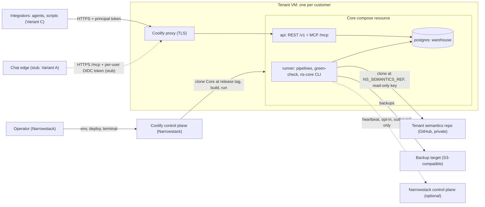
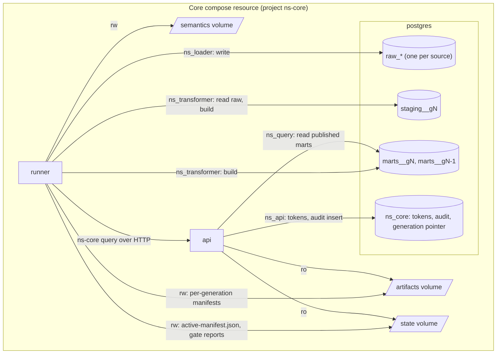
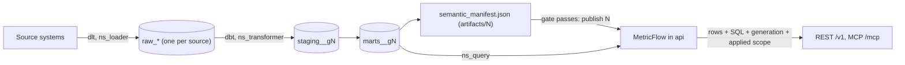

# Core runtime: system architecture

**Summary:** Core is one warehouse, one pipeline runner, and one Modeling API per tenant VM, deployed as a single Coolify compose resource. The API (REST, MCP, and the CLI through it) is the front door and bouncer: the only way to read a metric, and the place access is enforced. Variant C (headless) is Core itself and is on the initial execution path. The chat edge, model plane, and knowledge plane are **stubs**: documented so Core honors their contracts, not deployed first.

Everything here is **proposed** except the operator direction (Tucker, 2026-09-22) recorded in [decisions-and-open-questions.md](./decisions-and-open-questions.md). These are Phase G (govern) artifacts: building and deploying waits for the operator sign-off gate that opens Phase B (G8) per [wave-review-gate.md](../../process/wave-review-gate.md). The `runner/` and `api/` build contexts do not exist yet. Terms (Core, principal, access mode, generation, green-check, stub) are defined once in [README.md](./README.md#terms-used-here).

## Invariants

This doc owns the invariant list. Other docs cite an invariant by short name plus id, for example "denials leak nothing (INV-5)".

| ID | Short name | Invariant | Held by (requirement) |
|---|---|---|---|
| INV-1 | One enforcement point | Every metric read goes through the Modeling API enforcement point. REST, MCP, and CLI share one code path. No bypass, including the CLI. | CORE-API-01, CORE-API-07 |
| INV-2 | Warehouse credentials stay in Core | The warehouse DSN and warehouse credentials never leave Core services (runner, api). Edges, agents, and LiteLLM never hold them. | CORE-SEC-03, CORE-ACC-09, STUB-EDGE-07, STUB-MODEL-01 |
| INV-3 | MetricFlow is the only metric source | MetricFlow (fed by dbt) is the only source of metric definitions and numbers. Knowledge or vector content may describe metrics, never answer them. | STUB-KB-04 |
| INV-4 | Every answer shows its query | Compiled SQL and generation id are returned with every number. | CORE-API-04 |
| INV-5 | Denials leak nothing | A denied metric returns 403 with no value, no row count, no SQL. Denied names are omitted from listings. | CORE-API-02, CORE-API-05 |
| INV-6 | Allowlist applies in every mode | Allowlist default-deny applies in every access mode, including open. Open mode never exposes more than the allowlist ships. | CORE-GEN-02, CORE-ACC-03 |
| INV-7 | Per-role warehouse credentials | Loader, transformer, query engine, and API state each have a distinct credential. No shared password. | CORE-ACC-09 |
| INV-8 | Last-good generation survives | A failed gate never leaves the instance without its last-good generation (rollback-first, D11 in [decisions.md](../decisions.md)). | CORE-DEP-05, CORE-PIPE-05, CORE-GEN-06 |
| INV-9 | Outbound-only, non-degrading telemetry | Core has no inbound dependency on Narrowstack. Telemetry is outbound-only and consent-gated. The kill-switch never degrades pipelines, dbt, MetricFlow, or the API ([telemetry-protocol.md](../telemetry-protocol.md)). | CORE-TEL-01, CORE-TEL-02 |
| INV-10 | API is the only published surface | No host `ports:`. The warehouse and runner are unreachable from outside the VM. | CORE-SEC-01 |
| INV-11 | Secrets are runtime env only | Secrets are env var values set at runtime (Coolify UI or a gitignored `.env`). The manifest carries env var *names* only. Nothing secret is baked into images or committed. | CORE-SEC-02, CORE-PIPE-06 |
| INV-12 | Stubs are optional and swappable | Chat edge, model plane, and knowledge plane are optional and swappable. Turning them on changes no Core semantics, ACL, or MetricFlow definitions. | STUB-EDGE-01 |

## Context

*Caption: the only inbound path is the proxy to `api`; dashed edges are off by default (the chat edge is a stub, the control plane is opt-in).*

## Planes

| Plane | Parts | Responsibility | Status |
|---|---|---|---|
| Data: ingest | dlt, in the runner | Load the manifest's enabled pipelines into `raw_<source>` (CORE-PIPE-02) | core |
| Data: transform | dbt, in the runner | Build staging and marts with one durable entity key per mart, per generation (CORE-PIPE-03) | core |
| Data: semantic | MetricFlow + allowlist | Metric definitions and compiled SQL; default-deny on what ships (CORE-GEN-02) | core |
| Access | Modeling API: REST, MCP, enforcement library | Front door and bouncer: authenticate, filter metrics, inject row scope, audit ([access-control.md](./access-control.md)) | core |
| Operations | runner + `ns-core` CLI | Green-check, generations, schedule, rollback, backup, access setup | core |
| Chat edge | Open WebUI or LibreChat | Customer chat UI in front of Core (Variant A) | stub |
| Model plane | LiteLLM | Route LLM completions and track spend | stub |
| Knowledge plane | pgvector `kb` schema, `kb_search` / `kb_cite` | Document retrieval with a per-principal filter | stub |

Stub contracts live in [edge-stubs.md](./edge-stubs.md). Metric access uses three layers from [metric-acl.md](../../features/metric-acl.md): warehouse role grants, the semantic allowlist, and API principals. [access-control.md](./access-control.md) maps them.

## Container view

*Caption: the runner writes data and state; the API only reads published marts and writes its own `ns_core` schema.*

| Service | Does | Starts |
|---|---|---|
| `postgres` | Warehouse (Postgres 16, pgvector available but not created until the knowledge plane activates, STUB-KB-01). Holds `pgdata`. | first |
| `runner` | Long-lived (proposed). Entrypoint `ns-core bootstrap` runs green-check, publishes or keeps last-good, then runs scheduled refreshes with container-native cron. Hosts the operator CLI. Bootstraps roles, schemas, and grants as superuser, then drops to per-role credentials. | after `postgres` healthy |
| `api` | One process serving REST `/v1` and MCP `/mcp` through one enforcement library (CORE-API-01), with MetricFlow in-process. Loads the active generation from the volumes and hot-swaps on publish (CORE-API-10). The only service with a public route (CORE-SEC-01). | after `runner` healthy (CORE-DEP-05) |

Consequences of this shape:

- Green-check stages that need enforcement (ACL smoke, smoke query) run inside the runner through the same enforcement library, because the API starts only after the runner is healthy (CORE-GEN-04).
- Operators reach metrics only through the API, even from inside the runner (CORE-API-07). Ops commands act with operator authority; see [interface-contracts.md](./interface-contracts.md).
- Which credentials each service receives, and the env names, are owned by [deployment-coolify.md](./deployment-coolify.md). The service definition is [docker-compose.yml](../../../compose/local-warehouse/docker-compose.yml).
- MetricFlow is embeddable because releases from 0.209 are Apache-2.0 ([license](https://github.com/dbt-labs/metricflow/blob/main/LICENSE)). dbt-mcp is not Core's MCP: its semantic-layer tools need a dbt Platform account ([README](https://github.com/dbt-labs/dbt-mcp/blob/main/README.md)).

## One Core, two packagings

Variant A and Variant C are packaging profiles over one Core, not two Cores. This updates the "same spine" table in the superseded Cursor prototype.

| Layer | Shared Core (A and C) | Variant A only (stub) | Variant C only (in path) |
|---|---|---|---|
| Ingest and transform | dlt into Postgres, dbt marts per generation | none | none |
| Metric source of truth | MetricFlow, allowlist, three-layer ACL | none | none |
| Product surface | REST `/v1`, MCP `/mcp`, `ns-core` CLI, one enforcement library | Chat UI calls Core `/mcp` for metric tools | Integrator agents and scripts call `/v1` or `/mcp`; operators use the CLI |
| Caller identity | Core validates callers and runs no identity provider (operator direction) | Per-user IdP token, `oidc` access mode (CORE-ACC-11, STUB-EDGE-02) | Core-issued principal tokens, `token` access mode |
| Models and spend | Core calls no LLM | LiteLLM as its own resource (STUB-MODEL-01); never registers Core's MCP (STUB-MODEL-02) | Integrator's own concern, off-VM |
| Knowledge | not on the path | `kb_*` tools (stub) | same tools if activated |
| Pipelines | cron plus green-check in the runner | none | none |
| Where it runs | Core compose resource on the tenant VM | Separate Coolify resource on the same server (STUB-EDGE-01) | Off-VM; the example agent is a client, not a service (CORE-API-11, core later) |

Changes from the Cursor table: LiteLLM moves out of shared Core into the model-plane stub; MCP is part of the Core surface (proposed; canon delta pending); compose profiles are not used, because Coolify does not honor `profiles:` reliably ([coollabsio/coolify#6395](https://github.com/coollabsio/coolify/issues/6395)). Adding Variant A later changes neither the compose file nor the manifest (stubs are optional and swappable, INV-12).

## Data flow

*Caption: raw data is shared; staging and marts are built per generation; the API answers only from the published generation.*

- **Generation (proposed blue/green):** each successful build of the semantic layer is generation N, with its own `staging__gN` and `marts__gN` schemas and artifacts. Publish is an atomic pointer flip; N-1 is retained so rollback takes seconds (CORE-GEN-05, CORE-GEN-07). The canon alternative (in-place rebuild plus `pg_dump` snapshot) is an open decision.
- **Loads are full-refresh** into shared `raw_*`, so a failed refresh leaves the published marts untouched (CORE-PIPE-05).
- **Refresh never changes pins:** scheduled refreshes publish new generations with the same semantics SHA and Core version (CORE-PIPE-04).
- Stage order, refresh gate, and rollback sequences: [runtime-flows.md](./runtime-flows.md). `active-manifest.json` fields and the query response shape: [interface-contracts.md](./interface-contracts.md#state-files).

## Trust zones and boundaries

| Zone | Contains | Trust | Boundary rule |
|---|---|---|---|
| Public network | Integrators, future chat edge | Untrusted until authenticated | Reaches only `api`, through the Coolify proxy with TLS (INV-10) |
| Coolify control plane | Narrowstack's Coolify instance, operator | Full operator authority: sets env, deploys, opens container terminals | Multi-tenant control plane is allowed by ADR-003 (tenancy and isolation); data plane is not |
| Tenant VM, Core resource | `postgres`, `runner`, `api` on the resource's own network | Holds all tenant data and warehouse credentials | Each compose resource gets its own network; only the proxy joins it ([Coolify networking](https://next.coolify.io/docs/core/networking-in-coolify)) |
| Inside Core | Per-role warehouse credentials | Least privilege per service | Roles distinct (INV-7); API never holds superuser, loader, or transformer credentials (CORE-ACC-09) |
| Tenant semantics repo | dlt pipelines, dbt project, metrics, allowlist, manifest | Private tenant IP | Runner clones with a read-only deploy key scoped to one repo (CORE-PIPE-01, CORE-SEC-04) |
| Backup target | Warehouse backups | Customer data at rest off-VM | Written by the platform backup and `ns-core backup` (CORE-OPS-02) |
| Narrowstack control plane | Telemetry receiver | No inbound path into the VM | Off by default; outbound only, consent-gated (INV-9, CORE-TEL-01) |

Inside the API, open mode is a deliberate soft spot: callers are not authenticated, but the allowlist and warehouse grants still hold (INV-6, CORE-ACC-03). Setup and signals for it: [access-control.md](./access-control.md).

## Not in Core, and why

| Not in Core | Why | Where it lives |
|---|---|---|
| Reverse proxy, TLS | Coolify's proxy already routes the `api` domain | [deployment-coolify.md](./deployment-coolify.md) |
| Identity provider | Keep Core lean; Core validates tokens, it does not issue identities beyond its own principal tokens (operator direction) | Customer IdP, when `oidc` mode lands |
| Chat UI | Stub; the PRD skeleton is headless ([prd.md](../../product/prd.md) step 6) | [edge-stubs.md](./edge-stubs.md) |
| LLM gateway | Stub; Core computes numbers, it does not call models | [edge-stubs.md](./edge-stubs.md) |
| Knowledge plane on the path | Stub; no allowlist equivalent for documents yet (STUB-KB-03) | [edge-stubs.md](./edge-stubs.md) |
| Headless example agent as a service | It is an off-VM client and eval fixture | `examples/headless-agent/` (Phase B) |
| Scheduler platform (Prefect, Kestra) | Container-native cron plus green-check is enough for v1 | Open question in [decisions-and-open-questions.md](./decisions-and-open-questions.md) |
| External-warehouse mode | Deferred to wave W6; same images against a customer DSN | `compose/external-warehouse/` (stub) |
| Shared multi-tenant warehouse | ADR-003: one VM per customer | [decisions.md](../decisions.md) |
| `narrowstack-core-app`, BI product, row-level export | Deprecated (D8) or PRD and modeling-api non-goals | [prd.md](../../product/prd.md), [modeling-api.md](../../features/modeling-api.md) |
| Variant B (Onyx or RAGFlow dual plane) | Out of scope; later option only | [edge-stubs.md](./edge-stubs.md) |

## Relation to canon

- **[overview.md](../overview.md)** stays the repo overview. This set details its "provision, green-check, active-manifest" path and its four-step data flow for the local-warehouse mode.
- **[packaging.md](../packaging.md)** stays the deploy contract. This set keeps its green-check order and adds proposed stages (manifest validation, warehouse bootstrap, telemetry check), listed in [runtime-flows.md](./runtime-flows.md).
- **[prd.md](../../product/prd.md)** stays the product scope. Variant C proves walking-skeleton step 6 through the API or CLI. Treating MCP as part of the Core surface is a proposed canon delta (PRD lists it as "Could"; [modeling-api.md](../../features/modeling-api.md) lists it as a v1 non-goal). All deltas are tracked in [decisions-and-open-questions.md](./decisions-and-open-questions.md).
- **Supersedes [chat-with-modeled-data.md](../chat-with-modeled-data.md)** (Cursor prototype). It stays as provenance with a superseded stamp, as do [chat-data-plane/](../chat-data-plane/) and the [research pack](../../product/research/oss-agent-harness-chat-data-20260922/).

## Open questions (this doc)

Full list and owners: [decisions-and-open-questions.md](./decisions-and-open-questions.md).

- The `api` mounts only `artifacts` and `state`. Where does it read `principals[]`, `row_scope`, and the `access` block from: a copy in `artifacts/<N>/`, or the `ns_core` schema?
- The generation pointer lives in both `ns_core` and `state/active-manifest.json`. Which is authoritative for the API, and which role writes the `ns_core` pointer at publish?
- Canon data flow includes a "dashboard layer (allowlisted subset)". This design gives it no schema. Is it a mart subset, a separate schema per generation, or dropped for Core v1?
