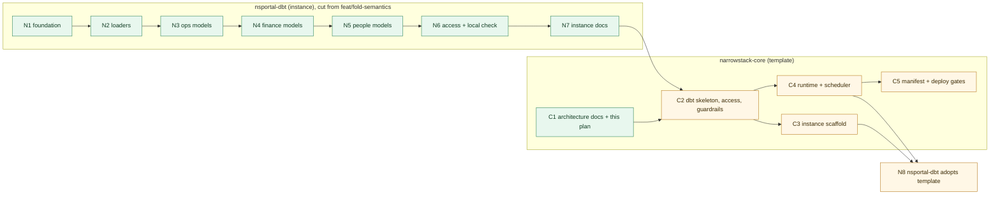

# Plan: split Core into a template and instances, and land it in reviewable PRs

> Status: proposed, 2026-10-02. Work status lives in Linear (project *Narrowstack Core (Stackflow)*: parents OS-399 for the instance stack, OS-581 for the template stack), not here.
> Supersedes the governance model in `narrowstack-core-architecture-20260831.md` (develop branch): no "Phase G before any build" gate. The thin-Core direction from the 2026-09-22 strategy session governs.

**Summary.** `narrowstack-core` becomes the template every tenant's Core is built from. Each tenant (Narrowstack included) gets an *instance* repo holding only its own sources, models and metrics. `nsportal-dbt` is Narrowstack's instance and today holds everything, generic and specific, in one 10k-line draft PR. This plan does three things:
- it says which file belongs in which repo;
- it says how instances pick up template changes;
- it lays out the PRs, in order, so the team can review each one on its own.

## Terms used here

| Term | Meaning |
|---|---|
| Core | The thin data platform: loaders (dlt, Airbyte) → Postgres → dbt → MetricFlow, run on a schedule. Nothing agentic. |
| Template | `narrowstack-core`: everything that is the same for every tenant. |
| Instance | One tenant's repo + deployment that implements the template. `nsportal-dbt` (Narrowstack) and one repo per customer. Instances differ only in schemas and pipelines. |
| Access tier | ops / finance / people: which warehouse role may read a model. The model's folder sets it. |
| Control-plane API | The portal's backend in Narrowstack Cloud (the "modeling API"). It provisions, access-controls and reads instances. It is not part of the template or the instance. |
| Stack (of PRs) | Small PRs merged in a fixed order. Each one is reviewed alone. |

## Decisions (2026-10-02, Tucker)

1. **Template consumption:** versioned package + scaffold that supports updates (copier). Details in [How instances consume the template](#how-instances-consume-the-template).
2. **Stalled `narrowstack-core` PRs (OS-395 → OS-399):** close them, and salvage the useful parts into core PRs C2–C5. Their branches stay for reference.
3. **`nsportal-dbt` draft PR #1:** split it into the N-stack below. Close #1 when the stack has landed.
4. **Where docs live:** the system map, the generic Core docs and this plan live in `narrowstack-core`. Instance docs stay in the instance, which links up to the template docs.

## What lives where

| `narrowstack-core` (template) | Instance repo (e.g. `nsportal-dbt`) |
|---|---|
| **Docs:** system map, layers, contributing, access-control pattern, control-plane API proposal | **Docs:** pipelines, metrics, warehouse (schemas + tiers), secrets file names, source notes, metric tie-outs |
| **dbt skeleton:** `dbt_project.yml` tier-folder layout + grants, `prod_profiles.yml`, schema-naming macro, schema-usage grant macro, MetricFlow time spine | **Models:** staging, marts, dashboard, semantic YAML, seed headers |
| **Access:** `access/roles.sql` (tier roles; agent login whose tier is set at deploy) | **Loaders:** one dlt pipeline per source plus helpers; Airbyte `etl_*` models; any instance-only views (e.g. the portal's `v_hetzner_*`) |
| **Guardrails:** no-data check, CI workflow, local end-to-end check | **Deploy-time choices, never in git:** enabled pipelines, agent tier, secrets |
| **Runtime:** image with dbt + dlt + MetricFlow, scheduler, env-loading and load-all scripts, dlt pipeline template | **Instance manifest** (once the schema exists) |
| **Deploy:** manifest schema + lint, deploy gates | |

Rule of thumb: if a customer instance would need the file unchanged, it belongs in the template.

## How instances consume the template

No existing open-source template covers dlt + dbt + MetricFlow + Postgres with upgradeable shared parts for many tenants (review 2026-10-02). We assemble it from maintained building blocks:

| Piece | How instances get it | Upgrade | Built on |
|---|---|---|---|
| Shared dbt code: schema macro, grant macros, role SQL, tests | dbt package in `narrowstack-core`, listed in the instance's `packages.yml`, pinned to a git tag | bump the tag | dbt packages; dbt native `grants:` (verified on Postgres 17); [dbt-project-evaluator](https://github.com/dbt-labs/dbt-project-evaluator) for structure lint |
| CI checks (no-data, parse, lint) | reusable GitHub workflow called by tag from the instance's CI file | bump the tag | GitHub reusable workflows |
| Runtime | container image with dbt + dlt + MetricFlow + scheduler, pinned by tag | bump the tag | official [dbt-postgres Dockerfile](https://github.com/dbt-labs/dbt-adapters/blob/main/dbt-postgres/docker/README.md) pattern |
| Scaffold: folder layout, doc stubs, CI file, `packages.yml`, manifest stub | [copier](https://github.com/copier-org/copier) template in `narrowstack-core`; new instances run `copier copy` | `copier update` merges template changes | copier (MIT, active) |

Rules:
- **The scaffold holds only files the tenant owns afterwards.** Anything that should change in lockstep across tenants goes in the package, workflow or image instead, so `copier update` rarely conflicts.
- **An instance never edits package code.** It overrides through dbt vars or its own macros.
- **Considered and skipped:** Meltano (a different loader stack), cruft (less active than copier), Permifrost (Snowflake-focused), Dagster (an orchestrator, not a template). We can revisit Dagster or the dlt dbt runner for scheduling in C4.

## PR sequence

C1 is docs only and can land now. C2 onward start after N6 proves the instance builds, which follows the "instance first, template second" principle.

### nsportal-dbt stack

Each PR is cut from `feat/fold-semantics` onto `main`, in order. Lines are approximate; ported SQL makes N3–N5 long, but each one covers a single domain.

| PR | Contents | Review focus | Done when |
|---|---|---|---|
| N1 foundation (OS-582) | `dbt_project.yml` (layer configs, no grants yet), `prod_profiles.yml` dev target, schema-naming macro, `.gitignore`, no-data check + CI, `requirements.txt` | Config only; deployed Airbyte models keep their schemas | CI green; `dbt parse` clean |
| N2 loaders (OS-583) | `dlt_pipelines/`, `scripts/` (env, load-all, bootstrap, smoke, freshness), `.secrets` templates | No secrets, tokens only from env | CI green |
| N3 ops models (OS-584) | Linear, GHL, social, Cloudflare, SuperOps tickets/assets: staging → marts → dashboard → semantic, plus time spine | Model logic, names | `dbt parse` clean |
| N4 finance models (OS-585) | Harvest invoices, Stripe ×2, SuperOps invoices/contracts, revenue spine, monthly aggregates | Revenue definitions match the tie-out doc | `dbt parse` clean |
| N5 people models (OS-586) | Gusto, bonus, Mercury bank, margin/unit economics, seed headers + types, cost-free time entries view | No names, figures or rows; payee-level data isolated | no-data check + `dbt parse` |
| N6 access + local check (OS-587) | Tier folders' grants + `meta`, people schemas, schema-usage macro, `access/roles.sql`, `local_verify.sh` | Who can read what; agent login hardening | `local_verify.sh` passes at `read_finance` and `read_people` |
| N7 instance docs (OS-588) | `docs/instance/*`, setup, source notes, tie-out; links to the template docs | Accuracy against the code | — |
| N8 adopt template (OS-594) | Replace generic files with the template package/scaffold; keep instance files | Nothing generic left in the instance | CI + `local_verify.sh` green |

### narrowstack-core stack

| PR | Contents | Salvaged from | Done when |
|---|---|---|---|
| C1 architecture docs (OS-589) | This plan, system map, layers, contributing, access-control pattern, control-plane API proposal; superseded-stamp on the 08-31 spec | nsportal-dbt PR #1 docs; OS-395 | Team review |
| C2 shared package, access, guardrails (OS-590) | Shared macros, roles SQL, tier-folder layout, no-data check, CI, time spine, as the shared package | nsportal-dbt N1/N6; OS-397 allowlist/ACL | A blank instance builds and passes the access probe |
| C3 instance scaffold (OS-591) | Template that creates a new instance repo (layout, docs stubs, CI, manifest stub) and supports updates | OS-399 semantics template tree | Scaffolding a test instance gives a green `dbt parse` |
| C4 runtime + scheduler (OS-592) | Image with dbt + dlt + MetricFlow; scheduled load → build; env/load scripts; dlt template | OS-398 local-warehouse compose | Instance runs on a schedule locally |
| C5 manifest + deploy gates (OS-593) | Manifest schema + lint; green-check, rollback, snapshot scripts | OS-396 manifest; OS-397 rollback; OS-398 green-check | Lint + gate tests pass in CI |

## Working agreements

- **One PR, one Linear ticket, one reviewer pass.** The PR title carries the ticket id. Stack PRs merge in order; don't start reviewing N(k+1) until N(k) is approved.
- **Cut the N-stack only after `feat/fold-semantics` is quiet.** Another agent (Cursor) is working on that branch. The stack is cut from a commit everyone agrees on, and nobody edits that branch afterwards.
- **No real data in any repo.** Seeds are header-only; there are no names, emails, IDs or money figures in code, comments or docs. CI enforces this from N1 onward.

## Out of scope here

Control-plane API build, row-level security, the cloud redeploy, the chat UI, telemetry. They are tracked in Linear milestones 2, 3 and 5.
