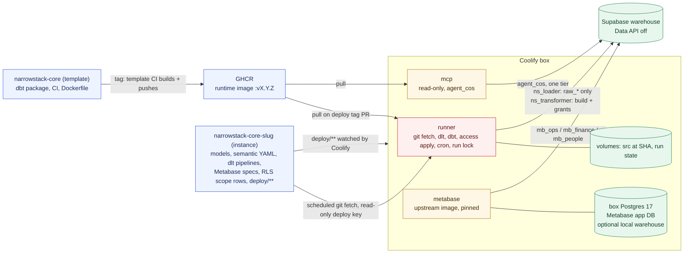
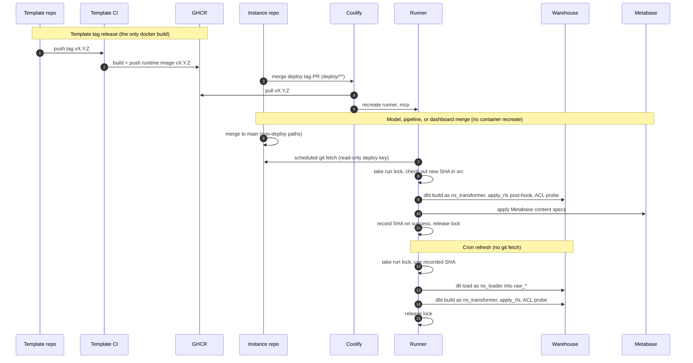

# Core template and instance architecture (v1)

> Status: decided, 2026-11-10. Work status lives in Linear (project *Narrowstack Core (Stackflow)*), not here.
> Supersedes [2026-10-02-core-template-instance-split.md](./2026-10-02-core-template-instance-split.md) for deploy shape, naming, and access. That plan's N-stack and C-stack PR sequence stands, with the [deltas](#deltas-to-the-2026-10-02-pr-sequence) below.

**Summary.**
- The runtime image is a versioned toolchain. It is built once per template tag and pulled from GHCR. Instance deploys never build it.
- Instance code (models, semantics, pipelines, dashboards, RLS scope rows) is git-fetched by the runner at a recorded SHA. Merging it does not rebuild or recreate containers.
- Data is never in the image or in git.
- Postgres is the only v1 policy engine: two writer roles, three read tiers, RLS keyed off `current_user`.
- Pilot: Coolify on a box, with a dedicated preexisting Supabase project as the warehouse.

## Naming

| Thing | Name |
|---|---|
| Template (public) | `narrowstack-core` |
| Instance repo | `narrowstack-core-<slug>`, same name in either org |
| Dogfood instance | `narrowstack-core-hq`. The GitHub repo stays `nsportal-dbt` until the fold is on `main` and a Coolify deploy from `main` has passed. |
| Customer example | `narrowstack-core-acme` |

Rejected: `narrowstack-warehouse`, `nsportal-dbt` and `narrowstack-semantics` as long-term names, `narrowstack-core-narrowstack`, `core-acme`.

## Shape

Red services write to the warehouse. Amber services read only, each login pinned to one tier.

## Image split

- **Runtime image (toolchain only).** Pinned dbt, dlt, MetricFlow, `ns-core` scripts, MCP adapter, supercronic. Built in template CI on a template tag, pushed to GHCR. Coolify pulls it; it never runs `docker build` on an instance deploy.
- **Instance code (git, not image).** dbt models, semantic YAML, dlt pipelines, Metabase content specs, RLS scope rows. The runner fetches these into the `src` volume and records the SHA. A merge touching only these paths does not rebuild or recreate containers.
- **Data (never image, never git).** Warehouse data lives in Supabase (pilot) or an optional local Postgres volume. Metabase's application DB lives in a box Postgres volume and survives image rebuilds.
- **New Python dependency** is the one instance-driven change that needs a template image bump. No runtime `pip install` in v1.
- **Metabase** is the upstream image pinned to an exact version. Not `:latest`, not baked into the runtime image.

| Component | Lives in | Updated by | Survives image rebuild |
|---|---|---|---|
| Runtime image | template repo, GHCR | template tag, then instance deploy tag PR | n/a |
| Metabase binary | upstream image, pin in `deploy/**` | pin bump PR | n/a |
| Compose, image pins | instance `deploy/**` | PR to `deploy/**` | yes (git) |
| Models, semantics, pipelines, Metabase specs, RLS scope rows | instance repo, `src` volume at SHA | merge to `main`, runner fetch | yes |
| Warehouse data | Supabase or local Postgres volume | dlt + dbt runs | yes |
| Metabase app DB | box Postgres volume | Metabase | yes |
| Run state (lock, recorded SHA, last run) | runner volume | runner | yes |
| Secrets | Coolify runtime env | operator | yes (never in image) |

| Change | Trigger | Containers recreated |
|---|---|---|
| Template tag | template CI builds and pushes image | none on instances |
| Deploy tag PR (image pin in `deploy/**`) | Coolify redeploy, pulls image | yes |
| Metabase pin or compose change in `deploy/**` | Coolify redeploy | yes |
| Coolify env or secret change | operator redeploy | yes |
| Models, semantics, pipelines, Metabase specs, RLS scope rows | runner scheduled git fetch | no |
| New Python dependency | template change, tag, deploy tag PR | yes |
| Cron refresh | supercronic in runner | no |

## Runtime flows

- **Sync** (fetch) runs only from the schedule. On failure the previous SHA stays recorded and keeps serving.
- **Refresh** runs dlt then dbt at the recorded SHA. It never fetches git.
- **Failure leaves last-good tables.** dbt replaces a table only when its build succeeds; failed and downstream models keep their previous relations. A failed ACL probe fails the run.
- **Run lock** serializes sync and refresh.

Rollback:
- Models: revert the commit. The next fetch builds the revert.
- Image: revert the deploy tag PR.
- Do not use Coolify's rollback button. It redeploys an older image with current config and restores no volume or database state.

## Access (v1)

Postgres is the only policy engine. Same SQL on box Postgres 17 and Supabase.

| Role | Kind | Can |
|---|---|---|
| `ns_loader` | runner login | write `raw_*` only |
| `ns_transformer` | runner login | build models, apply grants and RLS |
| `read_ops` < `read_finance` < `read_people` | NOLOGIN tier groups | read marts in their tier and below |
| `mb_ops`, `mb_finance`, `mb_people` | Metabase logins, one per tier | read one tier |
| `agent_cos` | MCP login | read one tier, chosen by the operator |

- Tier names come from instance config. The mechanism ships in the template dbt package.
- Reader logins are members of exactly one tier, with `default_transaction_read_only` and a statement timeout.
- Metabase gets one connection per tier because Metabase OSS cannot impersonate.
- RLS inside a tier keys off `current_user` via `acl.principal_scope`, loaded from the instance's RLS scope rows.
- The dbt `apply_rls` post-hook recreates policies after every rebuild. The ACL probe fails the run if a policy is missing.
- The admin DSN is used only by `ns-core access apply`.
- `staging`, `raw_*`, and `etl_*` are never granted to readers.
- Supabase: Data API off on the warehouse project. `service_role` and the anon key are never placed in Coolify, dbt, Metabase, or MCP. Supabase Auth users are not warehouse roles.

## Trust zones and invariants

- **Box:** runner, mcp, metabase, box Postgres. The only place warehouse credentials exist.
- **Warehouse:** Supabase project (or local volume). Reached only with per-role credentials.
- **GitHub:** template and instance code. No data, no secrets.
- **Operator:** Coolify env UI and the admin DSN.

Invariants:
- Warehouse credentials stay on the box.
- One credential per role. No shared logins.
- No host ports. The warehouse is never published; Metabase (and MCP, when a remote client needs it) route only through the Coolify proxy with TLS.
- Secrets are runtime env only, never in an image layer or git.

## Coolify notes

- **Per-service env.** List each variable only under the service that needs it. Writer passwords and source credentials reach only `runner`. Verify Coolify does not inject every resource variable into every container.
- **Runtime-only.** Turn the build-time flag off on every variable.
- **`$$` and required vars.** Escape literal `${...}` in compose health checks as `$${...}`. Use `${VAR:?message}` for required variables and confirm a missing one blocks the deploy.
- **Private instance repo.** Coolify's deploy key covers only its own clone of `deploy/**`. The runner needs its own read-only deploy key, scoped to the instance repo, for git fetch.
- **Watch paths.** Coolify watches only `deploy/**`. Other merges reach the box through the runner fetch.
- **Restore caveat.** Coolify's restore UI does not handle a database inside a compose resource. Restore of the box Postgres is scripted.
- **Restore drill (v1).** Restore the Metabase app DB and warehouse, fetch code at the recorded SHA, run `ns-core access apply` and a dbt build, and confirm a known question returns the pre-restore number.

First deploy checklist:
- [ ] Only the variables each service needs appear in its container env.
- [ ] `$$` escapes reach the container as literal `${...}`; health checks pass.
- [ ] A missing required variable blocks the deploy and names it.
- [ ] Runner fetches the private instance repo with its own key.
- [ ] A non-`deploy/**` merge does not trigger a Coolify redeploy.
- [ ] External scan finds only the proxy.
- [ ] One scheduled box Postgres backup lands and one restore drill passes.

## Pilot deploy

- Coolify on a box.
- Warehouse: preexisting dedicated Supabase project, not the app's Supabase project.
- Optional local Postgres warehouse stays a supported template mode, with the same role SQL.

## Cut from v1

Modeling API bouncer, principal tokens, OIDC, open mode, blue/green schema generations, pgvector, chat edge, telemetry, control-plane API, copier scaffold (until a second instance exists), manifest JSON schema.

Kept: tier grants, two writer roles, `apply_rls`, git sync, cron refresh, run lock, Metabase per-tier connections, a minimal read-only MCP, restore drill.

## Deltas to the 2026-10-02 PR sequence

- **C1 (OS-589):** this doc plus the Oct 2 plan. System map, layers, and contributing docs come in later C-stack PRs from the chat branch corpus. The control-plane API proposal is out of v1.
- **C2:** adds the two writer roles, tier groups, reader login hardening, `acl.principal_scope`, `apply_rls`, the ACL probe, and `ns-core access apply` to the shared package.
- **C3 (scaffold):** deferred until a second instance exists. Package, reusable workflow, and image stay the consumption path.
- **C4 (runtime):** toolchain image built on tag and pushed to GHCR; runner git sync, cron refresh, run lock; pinned upstream Metabase; minimal read-only MCP.
- **C5:** shrinks to `deploy/**` pins and the restore drill. Manifest schema, green-check generations, and snapshot scripts are out.
- **N6:** role names follow this doc (`ns_loader`, `ns_transformer`, `mb_*`, `agent_cos`).
- **N8:** also adds `deploy/**` pinned to a GHCR image tag.
- **Row-level security** moves into v1 (Oct 2 listed it out of scope).

## Branch salvage

Record only. No branch is deleted in this change.

- `docs/core-template-split` (PR #7): merges now.
- `feat/chat-data-architecture`: corpus for later C-stack PRs, not this merge. Contains `develop` and OS-399.
- `develop`, OS-399: contained in the chat branch; cut later.
- OS-395: archive. Its unique file is an executed PR-split map.
- OS-396, OS-397, OS-398, `feat/core-iac-spec`: cut later (older copies).
- `feat/core-phase-g`: archive later.
- Meeting-intelligence scaffold: held, not in v1.
- `narrowstack-semantics`: donor. Archive the GitHub repo only after the port lands and only on explicit operator instruction.
- `nsportal-dbt`: rename to `narrowstack-core-hq` only after the fold is on `main` and a Coolify deploy from `main` has passed.

## core-runtime draft docs: disposition

The uncommitted core-runtime draft docs in the agent worktree are not committed as a branch. A human can remove that worktree once this is accepted.

- **Discard:** README (Phase G gate); access-control model (open mode, HMAC tokens, filter injection, leadership/team/agent tiers); edge stubs; interface contracts except env-name discipline; requirements as a parallel ledger; the decisions file as a file (content belongs in Linear); the compose rewrite (pg16, no Metabase, `api`/`runner` build contexts that do not exist); build-vs-buy chat surface doc; dbt logs.
- **Incorporated above:** trust zones and invariants; per-role credentials; no host ports; runtime-only secrets; Coolify per-service env, `$$` and required-var handling, runtime deploy key, restore caveat, first deploy checklist; sync, refresh, and last-good failure flows.
- **Out of v1:** blue/green generations, pgvector, chat edge, Modeling API.

## Open items

- GHCR publish is blocked on org package-write auth. The image split needs that publish.
- Confirm dogfood slug `hq` (alternative: `internal`). This doc uses `hq`.
- Staging materialization (views vs tables) is an instance-repo question for Max.
- A public-branch confidentiality leak on `feat/chat-data-architecture` needs a fix-forward. Not part of this merge; no history rewrite.
- Coolify watch-path behavior on compose resources is unverified.
